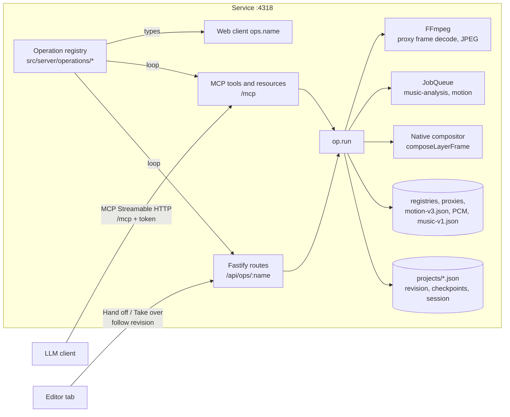

# Assistant rough cut through MCP

**Status: design and delivery plan; Phases 1 and 2 are implemented.** Nothing else below
is a current contract; the guides it links describe today's behaviour. The owner approved
Phase 0 on 2026-10-21 (see [decisions](#decisions-to-confirm)); later phases, routes, tool
names and constants remain proposals to confirm, amend or reject before work starts.

## Goal

The user imports the flight's recordings, makes a first pass (removing whole recordings
from the project and keeping only the interesting parts of the others), chooses a music
recording, then **hands the project off** to an LLM. Through an MCP server the LLM:

1. picks the footage parts worth using, inside what the user kept: it may remove more,
   never add back what the user eliminated;
2. places them on one or more video tracks in a coherent order;
3. sets transitions and fades;
4. grades each track and tunes each clip's Sharpen/Clarity/Denoise, with Auto adjust or
   individual settings;
5. **aligns cuts and transitions with the music**, which needs a new music analysis in
   the service;
6. finishes with a complete project the user reviews and edits in the editor before
   exporting.

While working, the LLM checks its result through stills and contact sheets rendered by
the service from the same compositor as export, plus text summaries of the timeline.

Non-goals: the assistant never imports, relinks, prepares, exports or deletes anything;
it never touches originals; it does not drive the editor's UI; it produces no new
rendering path, schema-less data or defaults. Export, project deletion and real-media
jobs stay with the user.

## What exists today

The plan builds on current code; these are the pieces it reuses or must change.

| Area                         | Today                                                                                                                                                                                                                                                                                                 | Consequence for the plan                                                                                                                                                             |
| ---------------------------- | ----------------------------------------------------------------------------------------------------------------------------------------------------------------------------------------------------------------------------------------------------------------------------------------------------- | ------------------------------------------------------------------------------------------------------------------------------------------------------------------------------------ |
| Project document             | Strict Zod schema ([model](../../src/shared/model.ts)); one JSON per project; `PUT /api/projects/:id` with `expectedRevision`, 409 on a stale revision ([storage](../../src/server/storage.ts)); `assertProjectSources` checks registered recordings and ranges                                       | The assistant writes through the same validated save; a concurrent editor tab must stop saving while it works                                                                        |
| Edits                        | One pure reducer, `applyCommand(document, command)` over the `EditCommand` union ([commands](../../src/shared/commands.ts)): insert/delete/trim/split/place/transition/fades/colour/speed/reverse/transform/detail/music/opacity/keyframes/tracks/bookmarks                                           | Every assistant edit is an existing command; no second edit vocabulary                                                                                                               |
| Layout                       | `calculateLayout()` and `sampleTimeline(project, frame)` ([timeline](../../src/shared/timeline.ts)) give placed clips, transitions and the per-frame `PreviewLayer` list                                                                                                                              | Text summaries and stills come from the authoritative layout                                                                                                                         |
| Native compositor            | `composeLayerFrame()` ([layered-frame](../../src/server/layered-frame.ts)) composes one project frame from per-source RGB8 content into premultiplied RGBA16, CPU pool of ≤ 8 workers; it is the export parity reference                                                                              | Stills reuse it unchanged                                                                                                                                                            |
| Recordings                   | Registry v2 ([media](../../src/shared/media.ts)): metadata, verified 720p proxy (`h264-720p-bt709-gop15-v1`, closed GOP 15), five thumbnails, `damage` ranges; project bin `media.videoIds`/`audioIds`                                                                                                | The assistant works only on prepared recordings in the bin                                                                                                                           |
| Camera motion                | Background job `motion` writes `motion-v3.json` (per-frame `tx/ty/zoom/rotation`, DJI telemetry); `motionProfile()` and `smoothRanges()` ([motion-analysis](../../src/shared/motion-analysis.ts)); `GET /api/media/:id/motion`                                                                        | Shot descriptors and steady ranges derive from it, no new decode                                                                                                                     |
| Music                        | `AudioLibrary` ([audio](../../src/server/audio.ts)) prepares a PCM16 48 kHz stereo cache (`pcm16-48k-stereo-mono-unity-v3`) and a ≤ 2,048-peak waveform; no tempo, beat or structure analysis                                                                                                         | **New music analysis job** reading that cache                                                                                                                                        |
| Auto adjust / AWB            | Pure estimators on RGBA bytes: `analyseAutoAdjust(frames)` ([auto-adjust](../../src/shared/auto-adjust.ts)), `frameIlluminant`/`poolWhiteBalance` ([white-balance](../../src/shared/white-balance.ts)); the editor samples frames with WebCodecs in the browser                                       | The service can run the same estimators on FFmpeg-decoded proxy frames                                                                                                               |
| Detail                       | Static clip `detail` with no estimator ([detail filters](DETAIL_FILTERS.md))                                                                                                                                                                                                                          | A noise/sharpness measurement helper is new                                                                                                                                          |
| First-pass selection         | Whole recordings leave the project with **Remove from project**; the Source preview's applied IN/OUT was **browser-local** (`pascap-media-ranges-<project>` in `localStorage`, one range per recording); it is now the recording's first kept range in the project's `selects`, copied into new clips | The user's kept ranges are invisible to the service: they must move into the project document                                                                                        |
| Jobs                         | `JobQueue` runs one heavy task at a time, `motion` in the background after other jobs ([jobs](../../src/server/jobs.ts), [media](../../src/shared/media.ts))                                                                                                                                          | Music analysis is another background kind; stills are not jobs                                                                                                                       |
| Service guards               | Loopback Fastify; every request needs an allowed Host/Origin and non-GET requests the `x-pascap-client` header ([app](../../src/server/app.ts)); 1 MiB body limit                                                                                                                                     | An MCP endpoint joins this API behind the same loopback checks, with its own token                                                                                                   |
| Request and response schemas | Every request body/params is a Zod schema in [app.ts](../../src/server/app.ts); the web client validates every response with Zod ([api.ts](../../src/web/api.ts)); but `EditCommand` is a plain TypeScript union, not a schema, and each route/client wrapper is written by hand                      | A single operation registry can generate the HTTP route, the MCP tool and the typed client from one definition; the edit vocabulary must become a schema to be exposed automatically |
| Dependencies                 | `fastify`, `@fastify/static`, `react`, `react-dom`, `zod` 4.6 ([package.json](../../package.json)), which has `.meta()` and `z.toJSONSchema()`; locked production-license inventory                                                                                                                   | Adding `@modelcontextprotocol/sdk` is a dependency change: risky route, licence inventory update, zod 4 compatibility check                                                          |

## Decisions to confirm

Confirmed by the owner on 2026-10-21: the operation registry, existing REST routes migrating
when touched or on demand, VS Code as the first MCP client, and music analysis shipping
first (done). The other rows are still proposals.

| Question                           | Proposal                                                                                                                                                                                                                                                                                                                                                                                                                                                                     | Why                                                                                                                                                                                                                                                                                                                                                                                                                                                                    |
| ---------------------------------- | ---------------------------------------------------------------------------------------------------------------------------------------------------------------------------------------------------------------------------------------------------------------------------------------------------------------------------------------------------------------------------------------------------------------------------------------------------------------------------- | ---------------------------------------------------------------------------------------------------------------------------------------------------------------------------------------------------------------------------------------------------------------------------------------------------------------------------------------------------------------------------------------------------------------------------------------------------------------------- |
| How service features reach the MCP | One **operation registry** in the service: each capability is defined once (name, LLM-facing description, Zod input/output with `.meta()`, access, audience, `run`). Three surfaces are generated from it in a loop each: the HTTP route `POST /api/ops/<name>`, the MCP tool and the typed web client. Adding a feature is adding one operation file; nothing is written twice.                                                                                             | The MCP must not be a second API to maintain. Zod schemas are the TypeScript equivalent of annotations: they already validate every request, and zod 4 converts them to the JSON Schema an MCP tool needs. TypeScript has no classpath scanning, so a registry array (tested for completeness) replaces decorator discovery.                                                                                                                                           |
| How the edit vocabulary is exposed | `EditCommand` becomes `editCommandSchema`, a Zod discriminated union with a description per variant and field; the type is `z.infer` of it (a type-equality test guards the migration). One `edit` operation takes a batch of commands.                                                                                                                                                                                                                                      | Every command added for the editor is then available to the assistant automatically, with its description, validation and error messages, and no wrapper tools are needed.                                                                                                                                                                                                                                                                                             |
| Where the MCP server runs          | **In the service**: a Streamable HTTP endpoint at `/mcp` on the existing loopback port, registered from the same registry, calling `op.run` directly. Access needs a token the service generates at startup (`<dataDir>/mcp-token`, shown in the Hand off dialog's configuration snippet) in place of the `x-pascap-client` header; Host/loopback checks stay. No separate process, no second backend.                                                                       | The service already owns the lease, the compositor pool, the job queue and the data directory, so in-process tools need no HTTP hop, token hand-over, body limit or request timeout, and can push progress later. Nothing new is published: the endpoint lives on the loopback port the editor already uses. VS Code, Claude Code and Codex connect to HTTP servers with a header; a stdio-only client uses the generic `mcp-remote` bridge, which is not PasCap code. |
| Where the user's kept ranges live  | New required project field **`selects`**: per recording in the bin, an ordered list of kept source ranges. No entry = the whole recording is available; `[]` is not allowed (remove the recording instead). Schema bump with migration (`selects: {}`) and frozen fixture per [data compatibility](../GITHUB_WORKFLOW.md#data-compatibility).                                                                                                                                | The assistant cannot read `localStorage`, and the rule "never add back" needs a server-checkable source of truth. The Source preview's applied range becomes a view of the first select, so the UI change is small.                                                                                                                                                                                                                                                    |
| How the assistant edits            | The `edit` operation `{ commands, expectedRevision }`: the service applies the batch atomically with `applyCommand`, validates like a save and writes one revision. Candidates (`preview_edits`, `still` of a draft) are also `commands` relative to a saved revision, never whole documents. The editor keeps its document saves.                                                                                                                                           | One validation path and one revision per logical step (the assistant's "one Undo step"); rich command errors come back verbatim; commands stay small under the 1 MiB body limit where a large project document would not; the editor can adopt it later for bulk actions.                                                                                                                                                                                              |
| Concurrency with the open editor   | A server-side **assistant session** (lease) per project: started from the editor's **Hand off** dialog after flushing autosave, with a **checkpoint** copy of the document. While it holds the lease, editor saves get 423 and the editor follows the document read-only (polling revision); `edit` requires the lease. The user can **Take over** at any time; the LLM can end the session with notes (`session_end`). The lease expires after 10 min without MCP activity. | Same project, no silent divergence, nothing destructive: the checkpoint restores the pre-hand-off cut through **Open project file…** (new project) or a **Restore checkpoint** action. A `copy: true` option builds the cut in a new project instead, using the existing import path.                                                                                                                                                                                  |
| How the LLM sees pictures          | **Native stills** from the proxies through `composeLayerFrame`, encoded to JPEG by FFmpeg, served by new routes; contact sheets tile several stills with a JSON legend. No browser screenshots.                                                                                                                                                                                                                                                                              | The composed picture is what matters, it matches export, and it needs no GPU or Chrome. The editor UI is for the user.                                                                                                                                                                                                                                                                                                                                                 |
| Music analysis                     | A new background job kind (`music-analysis`) on the existing PCM cache: onset envelope, tempo, beats, downbeats, loudness, sections and accents, cached as `music-v1.json`; pure TypeScript in a worker thread, no new dependency or decoder.                                                                                                                                                                                                                                | The PCM is already exact 48 kHz stereo; a bounded single-thread analysis takes about a second per song. It also gives the editor beat ticks and **Beats → bookmarks** without the assistant.                                                                                                                                                                                                                                                                           |
| Export                             | Not exposed.                                                                                                                                                                                                                                                                                                                                                                                                                                                                 | The user reviews first; export remains a deliberate action with its own storage checks.                                                                                                                                                                                                                                                                                                                                                                                |

## Architecture



The registry is the only place a capability is described; the HTTP routes serve the
editor, the MCP endpoint serves the LLM, and both call the same `run`. The MCP layer adds
only what the protocol needs: JSON Schema from the Zod input, image content for stills,
timecode beside frames, and the service's validation messages as tool errors.

## Data model changes

### Project `selects` (schema bump)

```ts
selects: Record<mediaId, SelectRange[]>; // SelectRange = { sourceIn, sourceOut }, OUT exclusive
```

- Keys must be in `media.videoIds`; ranges are within the registered frame count, unique,
  ascending, non-overlapping, at least one frame; no empty arrays.
- Removing a recording from the project removes its entry; a clip may use frames outside
  the selects (the user can always do what they want in the editor). Only **assistant
  sessions** are bound: every clip they insert, trim or place must lie inside one select
  of its recording, and a `selects` change they make must be a subset of the previous one
  (`narrow` only). The service enforces this in `edit` during a session.
- Migration: add `selects: {}`. The Source preview keeps its applied IN/OUT; applying a
  range writes it as the recording's single select (one Undo step through a new
  `select-set` command); a later **Keep this range too** adds a second one. Clips still copy
  the applied range as before.

### Assistant session and checkpoint (service files, not schema)

`projects/<id>.assistant.json`: `{ token, startedAt, lastActivityAt, brief, notes, edits }`
written by the service; `projects/<id>.checkpoint-<iso>.json` holds the document as handed
off (bounded to the last 5 checkpoints per project). Neither is part of the project
document, export receipts or compatibility rules.

The **brief** is what the user tells the assistant in the Hand off dialog: chosen music
track or music recording, target length (`follow music` | seconds), style notes (free
text, ≤ 2,000 characters), allowed camera movement (the Source preview tolerance, 0.5–6),
whether speed changes, several tracks and picture-in-picture are allowed, and the maximum
number of clips. It is exposed to the LLM as a resource and never interpreted by the
service.

### Music analysis cache

`audio-assets/<id>/pcm16-48k-stereo-mono-unity-v3/music-v1.json`, tied to the PCM cache
(stored alongside it; removed with it; ignored if the asset's `content` changed):

```ts
{
  version: 1,
  sampleRate: 48000, hop: 480,             // 10 ms feature rate
  tempo: { bpm, confidence },              // global; curve: [{ fromSample, bpm }]
  meter: { beatsPerBar: 3 | 4, confidence },
  beats: [{ sample, strength, downbeat }], // ascending samples
  accents: [{ sample, strength }],         // strong isolated onsets
  loudness: number[],                      // dBFS per 100 ms
  sections: [{ fromSample, toSample, kind: 'quiet' | 'build' | 'peak' | 'release', loudnessDb }]
}
```

Positions are PCM samples; the service converts to music-source frames and project frames
when asked (project frame = `start + (sourceFrame − sourceIn)`, through loops; see
`musicSourceFrame` in [audio](../../src/shared/audio.ts)). Arrays are bounded by song
length: a 10-minute song has about 1,500 beats and 6,000 loudness values.

## The operation registry

Every capability is one definition in `src/shared/operations/` (pure Zod, so the web
client can validate responses with it) and its `run` in `src/server/operations/`:

```ts
export interface OperationSpec<N, I, O> {
  name: N; // unique snake_case; the tool name and the route segment
  description: string; // written for the LLM: when to use it, what it returns
  input: I; // a Zod object whose fields carry .meta({ description })
  output: O; // a Zod schema; later also images (bytes plus a JSON legend)
  access: 'read' | 'write'; // write bumps the revision (and later needs the session lease)
  audience: readonly ('editor' | 'assistant')[]; // required, no default
}
// src/server/operations/index.ts
export const runners: { [N in OperationName]: (context, input) => Promise<output> };
```

`src/shared/operations/index.ts` exports the `operations` array; a definition that is not
in the array does not exist, and an operation without a runner fails type checking.
From that array:

- **HTTP**: one loop registers `POST /api/ops/<name>` per operation (parse `input`, call
  `run`, check and send `output`) behind the existing loopback and client guards; the
  existing REST routes stay as they are and migrate one at a time when touched or when
  an operation needs them.
- **MCP**: one loop registers one tool per operation whose `audience` includes
  `assistant`, with `z.toJSONSchema(op.input)` and `op.description`; image outputs
  become MCP image content plus the legend as text.
- **Web client**: `callOperation(name, input)` ([operations](../../src/web/operations.ts)),
  typed from the array and validating the response with the operation's output schema,
  so the editor can use new operations (bulk actions, beats to bookmarks) without a
  wrapper in `api.ts`.
- **Docs**: `npm run operations:catalogue` writes the [catalogue](#operation-catalogue)
  below from the array; a unit test, and so `npm run check`, fails when it drifts.

Drift gates, as unit tests over the array: unique snake_case names; non-empty
descriptions; every input and output converts to JSON Schema; every input field is
described; `audience` set explicitly; one runner per operation. A contract test runs the
operations through their HTTP routes on a disposable service; Phase 5 adds the same
fixture through an in-memory MCP client against the in-process endpoint.

What stays manual: the playbook (when to use what), noted descriptions where a
`.refine()` rule cannot appear in JSON Schema (clip `sourceOut > sourceIn`, the layout
refinement), and the `audience` decision for each operation. Decorators would add nothing:
they still need the module imported to register, and the schema would be harder to read
and test.

### `editCommandSchema`

`EditCommand` ([commands](../../src/shared/commands.ts)) is `z.infer` of
`editCommandSchema` ([command schema](../../src/shared/command-schema.ts)), a Zod
discriminated union on `type`, each variant and field with a `.meta({ description })`
written for the LLM. A compile-time equality test keeps it identical to the former
hand-written union, and `applyCommand` is unchanged. The `edit` operation's input is
`{ projectId, expectedRevision, commands: editCommandSchema.array().max(64) }`. Any command
added later for the editor is exposed to the assistant the moment it is in the union.

### Operation catalogue

<!-- operation-catalogue:start -->

<!-- Generated from src/shared/operations by `npm run operations:catalogue`; edit the definitions, not this text. -->

#### `describe_project`

Read; for editor and assistant. Summarise a saved project: its revision, duration, video tracks with their clips in timeline order (project frames and timecodes, source ranges, speed, direction), transitions, music tracks, the recordings with the ranges the user kept, and bookmarks. Frames are integers at 30000/1001 fps. Read it before editing and after each edit batch.

| Input       | Type   | Description              |
| ----------- | ------ | ------------------------ |
| `projectId` | string | ID of the saved project. |

#### `edit`

Write; for editor and assistant. Apply up to 64 edit commands to a saved project, in order, as one step: either every command applies and the project is saved once with the next revision, or nothing changes and the first rejected command's reason is returned. A stale expectedRevision is rejected; read the project again first.

| Input              | Type            | Description                                                          |
| ------------------ | --------------- | -------------------------------------------------------------------- |
| `projectId`        | string          | ID of the saved project.                                             |
| `expectedRevision` | integer         | Revision the commands were written against, from describe_project.   |
| `commands`         | array of object | Commands applied in order; each sees the result of the previous one. |

#### Edit commands

The `commands` of `edit`; their fields are described in the JSON Schema of the tool.

| Command               | Fields                                         | Description                                                                                                                                                                                                                                                                                               |
| --------------------- | ---------------------------------------------- | --------------------------------------------------------------------------------------------------------------------------------------------------------------------------------------------------------------------------------------------------------------------------------------------------------- |
| `insert`              | `clip`, `index`                                | Insert a new video clip into the project clip array. A Ripple track plays its clips in array order, packed from its first clip; a track without Ripple places it at clip.start, and it must not overlap another clip.                                                                                     |
| `delete`              | `clipId`                                       | Remove a clip. A Ripple track closes the gap; on a track without Ripple the other clips keep their starts.                                                                                                                                                                                                |
| `reorder`             | `clipIds`                                      | Reorder the whole project clip array; Ripple tracks play their clips in this order. Transitions between clips that are no longer adjacent become cuts.                                                                                                                                                    |
| `trim`                | `clipId`, `sourceIn`, `sourceOut`              | Change a clip's source range. Its start stays; a Ripple track re-sequences the clips after it. Transitions or fades that no longer fit reject the edit.                                                                                                                                                   |
| `trim-place`          | `clipId`, `sourceIn`, `sourceOut`, `start`     | Change a clip's source range and start together, like a left-edge trim. On a Ripple track only the first clip's start can change; later starts follow the sequence.                                                                                                                                       |
| `split`               | `clipId`, `sourceFrame`, `newClipId`           | Split a clip into two clips with independent settings, joined by a cut; the second clip on the timeline gets newClipId. A reversed clip keeps its higher source frames first.                                                                                                                             |
| `remove-source-range` | `clipId`, `sourceIn`, `sourceOut`, `newClipId` | Cut source frames [sourceIn, sourceOut) out of a clip. Removing the middle leaves two clips; removing an end trims the clip; removing everything deletes it. A Ripple track closes the gap; otherwise the remaining pieces keep their timeline positions. The range must lie within the clip's own range. |
| `duplicate`           | `clipId`, `newClipId`                          | Copy a clip (range, speed, direction and detail) right after it. A Ripple track inserts the copy into its sequence; otherwise it starts at the original's end and must not overlap another clip.                                                                                                          |
| `colour`              | `layerId`, `colour`                            | Replace a video track's complete Colour; it applies to every clip on the track. Settings with track keyframes follow their keyframes instead of these base values.                                                                                                                                        |
| `speed`               | `clipId`, `speed`                              | Set a clip's speed. Its duration changes with it: a Ripple track re-sequences the clips after it, and overlaps or transitions that no longer fit reject the edit.                                                                                                                                         |
| `reverse`             | `clipId`, `reverse`                            | Play a clip backwards or forwards; its duration and placement do not change.                                                                                                                                                                                                                              |
| `transform`           | `layerId`, `transform`                         | Replace a video track's Transform; it applies to every clip on the track at project time.                                                                                                                                                                                                                 |
| `detail`              | `clipId`, `detail`                             | Set a clip's static detail filters, applied before the track's Colour.                                                                                                                                                                                                                                    |
| `music`               | `music`                                        | Replace every music track of the project.                                                                                                                                                                                                                                                                 |
| `opacity`             | `layerId`, `opacity`                           | Set a video track's Opacity where it has no Opacity keyframes; it applies to every clip.                                                                                                                                                                                                                  |
| `layer-key-toggle`    | `layerId`, `frame`, `setting`, `value`         | Enable a setting at a track keyframe with value, creating the keyframe at frame if needed; or disable it there if it is already enabled, removing the keyframe with its last setting.                                                                                                                     |
| `layer-key-value`     | `layerId`, `frame`, `setting`, `value`         | Change the value of a setting already enabled at a track keyframe.                                                                                                                                                                                                                                        |
| `layer-key-move`      | `layerId`, `frame`, `nextFrame`                | Move a whole track keyframe, with all its settings and Easing, to another project frame; an occupied frame rejects the edit.                                                                                                                                                                              |
| `layer-key-remove`    | `layerId`, `frame`                             | Remove a whole track keyframe.                                                                                                                                                                                                                                                                            |
| `layer-key-default`   | `layerId`, `frame`                             | Add a default keyframe, which returns every Colour setting and Opacity to neutral from its frame on, or remove the default keyframe already there. Rejected where an ordinary keyframe exists.                                                                                                            |
| `layer-key-easing`    | `layerId`, `frame`, `setting`, `interpolation` | Set the Easing of a track keyframe's settings toward their next keyframes.                                                                                                                                                                                                                                |
| `layer-add`           | `layer`                                        | Add a video track on top of the others; a project has at most 8.                                                                                                                                                                                                                                          |
| `layer-update`        | `layer`                                        | Replace a video track's settings. Turning Ripple on packs its clips from the first one's start; turning it off keeps their current starts.                                                                                                                                                                |
| `layer-remove`        | `layerId`                                      | Delete a video track and its clips; the last track cannot be deleted.                                                                                                                                                                                                                                     |
| `layer-order`         | `layerIds`                                     | Set the composition order of the video tracks, bottom first.                                                                                                                                                                                                                                              |
| `place`               | `clipId`, `layerId`, `start`, `index`          | Move a clip to a track and position. On a Ripple track the array position decides its place in the sequence and start must equal the resulting start, unless it is the first clip.                                                                                                                        |
| `move-clips`          | `clipIds`, `delta`, `layerId`                  | Move several clips together by the same number of frames. Overlaps, a start before frame 0 or transitions that no longer fit reject the whole move.                                                                                                                                                       |
| `transition`          | `transition`                                   | Set the transition between two adjacent clips of a track. Non-cut transitions need touching clips or an existing dissolve; without Ripple a dissolve or pause moves the right clip.                                                                                                                       |
| `fades`               | `layerId`, `opening`, `closing`                | Set a video track's fade from black at its first clip and to black at its last clip.                                                                                                                                                                                                                      |
| `bookmark-add`        | `frame`                                        | Add a bookmark, a snap point that is never rendered; at most 1,000.                                                                                                                                                                                                                                       |
| `bookmark-move`       | `frame`, `nextFrame`                           | Move a bookmark; an occupied frame rejects the edit.                                                                                                                                                                                                                                                      |
| `bookmark-remove`     | `frame`                                        | Remove a bookmark.                                                                                                                                                                                                                                                                                        |
| `select-set`          | `mediaId`, `ranges`                            | Replace a recording's kept ranges; an empty list makes the whole recording available again. Kept ranges never retime or render anything.                                                                                                                                                                  |
| `select-narrow`       | `mediaId`, `ranges`                            | Replace a recording's kept ranges with ranges inside the existing ones; it never keeps more frames.                                                                                                                                                                                                       |

<!-- operation-catalogue:end -->

## Operations

The first operations. Session and editor-only ones are listed because they share the
registry; the assistant never sees them.

| Operation            | Audience  | Purpose                                                                                                                                                                                   | Bounds                                                                                               |
| -------------------- | --------- | ----------------------------------------------------------------------------------------------------------------------------------------------------------------------------------------- | ---------------------------------------------------------------------------------------------------- |
| `session_start`      | editor    | Start an assistant session: checkpoint, brief, lease token; refuses when a session is active, recordings in the bin are not ready, or autosave is dirty (the editor flushes first)        | One session per project                                                                              |
| `session_status`     | both      | State, brief, edit log, notes (editor banner and LLM resource)                                                                                                                            |                                                                                                      |
| `session_end`        | both      | Take over (editor) or finish with notes (assistant); the notes appear in the editor's hand-off dialog                                                                                     |                                                                                                      |
| `checkpoint`         | both      | Named checkpoint of the current document; `checkpoint_restore` (editor only) replaces the document in one revision after checkpointing the current state                                  | Last 5 per project                                                                                   |
| `edit`               | both      | Apply a batch of commands atomically; with a session it also enforces selects and bin membership; returns the new revision and a one-line summary, or the first failing command's message | ≤ 64 commands                                                                                        |
| `preview_edits`      | assistant | Dry run of a batch against the saved revision: resulting timeline summary and errors, no save                                                                                             |                                                                                                      |
| `describe_project`   | both      | Compact timeline: tracks, clips with timecodes, transitions, music, bookmarks, selects, alignment summary; `detail: summary \| full`                                                      |                                                                                                      |
| `describe_recording` | both      | Shot descriptors (below) inside the selects, telemetry, damage; `tolerance`                                                                                                               | Computed on request, no cache                                                                        |
| `still`              | both      | One composed project frame from the proxies (`frame`, `width ≤ 1280`, `crop?`, `commands?` for a candidate), JPEG                                                                         | Serial, one FFmpeg child at a time, two waiting; refused (409) while an export or reference job runs |
| `timeline_sheet`     | both      | Contact sheet of ≤ 12 project frames (`frames[]` or `from/to/count`), JPEG plus legend                                                                                                    | Same as still                                                                                        |
| `source_frame`       | both      | One proxy source frame (`mediaId`, `frame`, `width`, `crop?`), JPEG; `recording_sheet` for a source range                                                                                 | Same as still                                                                                        |
| `estimate`           | both      | `{ clipId or mediaId + range, kind: auto-adjust \| white-balance \| detail }`: decodes ≤ 16 proxy frames at ≤ 320 × 180 and runs the shared estimators or the detail heuristics           | Serial with stills                                                                                   |
| `music_analyse`      | editor    | Queue the music analysis job; `music_analysis` (both) returns `{ analysis, job }`, with beats/accents in a window as samples, source frames and project frames                            | Background job kind                                                                                  |
| `check_alignment`    | both      | Boundary-to-beat report (below)                                                                                                                                                           | Pure, bounded by clip/beat counts                                                                    |
| `snap_cuts_to_beats` | both      | `layerId`, `prefer: beat \| downbeat`, `minimumSeconds`, `apply`: the alignment helper, a proposal or one `edit` batch                                                                    |                                                                                                      |
| `beats_to_bookmarks` | both      | Add a music track's beats or downbeats as bookmarks in one revision; the editor's **Beats → bookmarks** uses it too                                                                       | ≤ 1,000 bookmarks                                                                                    |

There are deliberately no `add_clip`/`set_transition`-style wrappers: those are `edit`
commands, already described in `editCommandSchema`, and a wrapper would be a second place
to maintain. Brief permissions (speed, several tracks, picture-in-picture) are enforced in
`edit` by command type during a session.

### Stills and contact sheets

Pipeline for project frame $f$:

1. `sampleTimeline(document, f)` (and `sampleSlots` for transition timeslots) gives the
   active sources with evaluated Colour, Transform, Detail, weights and Opacity.
2. For each source, decode proxy frame `sourceFrame` with FFmpeg: `-ss` to the keyframe at
   or before it (closed GOP 15, uniform 1001/30000 durations), `select` the exact frame,
   output `rgb24`, verify exactly one frame. Damaged ranges follow the proxy, which is
   already black there.
3. `composeLayerFrame` composes the group(s) at proxy size into the RGBA16 accumulator
   (bottom-to-top source-over as export does, see
   [group composition](../LAYERS_AND_KEYFRAMES.md#group-composition)).
4. Flatten over opaque black, scale to the requested width, encode JPEG (quality 80) with
   FFmpeg from raw input; sheets copy each still into a grid before one encode and return a
   legend `{ cell, frame, timecode, clipIds }` instead of burnt-in text (no libfreetype
   dependency).

Optional `commands` apply to the saved revision in memory before composing, so the LLM can
compare a grade or a transition without a revision; the draft is validated exactly like a
save and never written.
Default size 640 × 360 (about 50 KB); a `crop` at 1:1 proxy pixels serves judging Sharpen
and Denoise. Stills show the 720p proxy composition: the export at 4K differs in
resolution only, as the preview does today ([detail filters](DETAIL_FILTERS.md#kernel)).
A 720p frame composes in well under a second on the CPU pool; the GPU worker is not used.

### Shot descriptors

Derived per recording from the motion analysis and telemetry, without decoding:

- the steady ranges at the brief's tolerance (`smoothRanges`), each with duration, mean
  and peak camera speed, roughness, a motion class (`static`, `pan left/right`,
  `tilt up/down`, `push in/out`, `orbit`, `mixed`, from the sign and share of
  `tx`/`ty`/`zoom`/`rotation`), and telemetry means (height, distance, horizontal and
  vertical speed) where present;
- recording-level facts: duration, damage, hovering shares, telemetry extremes, file name;
- optional picture facts from the five thumbnails (mean luma, colourfulness through
  `toneStatistics`), cheap and already decoded.

They are intersected with the project's `selects`, so the LLM only ever sees usable
ranges.

### Server-side Auto adjust, white balance and detail measurement

The `estimate` operation decodes the frames `autoAdjustFrames(sourceIn, sourceOut)`
(or the white-balance window) from the proxy, scaled to at most 320 × 180 with a bilinear
scaler, to RGBA and runs the unchanged estimators. The browser samples through a canvas, so pixels differ
slightly from FFmpeg's scaler: the results agree within tolerance but are not bit-identical
with **Auto** in the editor; the unit test fixes that tolerance. The LLM applies the
result through the existing `colour` command, scaled by the same `scaleCorrection` and
intensity rule ([Auto adjust](AUTO_ADJUST.md)); animated settings are reported and left
alone, like the popover does.

Detail has no estimator today. The `detail` kind returns measurements, not settings: noise
level (median absolute high-pass residual in flat 8 × 8 blocks, in 8-bit codes), sharpness
(gradient energy at the proxy scale) and compression blockiness, each with a suggested
starting value (Denoise from noise above about 1.5 codes; Sharpen 0.2–0.5 by sharpness;
Clarity 0–0.2). They are heuristics the LLM confirms on 1:1 crops; they are kept in one
module with their constants, like `AUTO_ADJUST`, so the owner can tune them on real
flights.

## Music analysis

Implemented ahead of the registry (owner, 2026-10-20): the job and cache are served by
`GET`/`POST /api/audio/<id>/analysis`, described in
[speed and audio](../SPEED_AND_AUDIO.md#music-analysis); `music_analyse` and
`music_analysis` will wrap them once the registry exists. The design as proposed:

Runs in a worker thread (as `motion-pool` does), streaming the PCM cache in 1 MiB blocks,
mono downmix in float; no new dependency (a small radix-2 FFT in TypeScript).

| Stage          | Method                                                                                                                                                                                                                                                |
| -------------- | ----------------------------------------------------------------------------------------------------------------------------------------------------------------------------------------------------------------------------------------------------- |
| Features       | 2,048-sample Hann window, hop 480 (100 Hz); 40 triangular bands 30 Hz–16 kHz, log compression                                                                                                                                                         |
| Onset envelope | Half-wave rectified spectral flux summed over bands, smoothed, normalised; 12-bin chroma-lite per frame for structure                                                                                                                                 |
| Tempo          | Autocorrelation of the envelope over 8 s windows with a log-normal prior centred at 120 BPM, candidates 50–220 BPM (Ellis 2007); global tempo and a per-window curve; octave errors resolved towards the prior; confidence from the peak's prominence |
| Beats          | Dynamic-programming beat tracking on the envelope at the local tempo, refined to the nearest onset peak within ±20 ms; `strength` from the envelope                                                                                                   |
| Downbeats      | Among 4 (then 3) phases, the one maximising mean onset strength plus low-band energy at candidate downbeats; `meter` with a confidence; a heuristic the LLM may ignore                                                                                |
| Loudness       | RMS per 100 ms in dBFS                                                                                                                                                                                                                                |
| Sections       | Novelty from a checkerboard kernel over the self-similarity of 1 s band-energy and chroma averages; boundaries at prominent peaks with sections ≥ 8 s; kinds from relative loudness and slope (`quiet`, `build`, `peak`, `release`)                   |
| Accents        | Envelope peaks above the 90th percentile at least 150 ms apart: hits worth cutting on                                                                                                                                                                 |

Bounds: features for a 10-minute song are 60,000 × 40 floats (about 10 MB) and the PCM is
never held whole; one analysis at a time, in the background after other jobs, cancellable,
tied to the PCM cache's identity like `motion-v3.json` is to the proxy's `verifiedAt`.
Missing analysis for an older cache shows an explicit **Analyse music** action; nothing is
rewritten silently.

Validation uses synthetic signals only: click tracks and amplitude-modulated noise at
60–200 BPM with offsets, swing, a tempo change and added noise; beats within ±35 ms
(about one project frame) at F-measure ≥ 0.95, tempo within 2 % (or its double/half
flagged), downbeats ≥ 0.8 on accented bars, sections at synthetic loudness steps;
deterministic results; a loop-placed music track maps beats to project frames across the
wrap. Real songs are evaluated by the owner, not by CI.

Editor value independent of the assistant: beat ticks (downbeats stronger) on each music
lane from its analysis, and **Beats → bookmarks** in **Audio → Music** (all beats or
downbeats only, within the music track's placement) adding at most 1,000 bookmarks in one
Undo step, after which every snapping gesture lands on the beat
([bookmarks](../TIMELINE_EDITING.md#bookmarks)). A 3-minute song at 120 BPM is 360
beats; the action reports when it would exceed the limit and offers downbeats only.

### Alignment helpers

- `check_alignment`: for every boundary of every video track, the moment the viewer perceives
  (cut frame; middle of a dissolve; middle of a black pause), the nearest beat and
  downbeat with signed offsets in frames, and a summary (share of boundaries within one
  frame of a beat). Also the first and last video frame against the music's first/last
  beat and sections.
- `snap_cuts_to_beats`: on one Ripple track, shorten clips' OUT (or IN) inside their
  selects so each boundary lands on the nearest beat or downbeat at or before its current
  position, keeping each clip at least `minimumSeconds` long and honouring existing
  dissolve overlaps; returns the resulting `trim` commands as a proposal (`apply: false`)
  or applies them as one batch. Deterministic arithmetic the LLM should not do by hand.
- `beats_to_bookmarks`: the editor action above, for the LLM.

## MCP server

`src/server/mcp.ts` registers the endpoint on the Fastify app: one `McpServer` from
`@modelcontextprotocol/sdk` whose tools and resources are built from the registry in a
loop, and a Streamable HTTP transport served at `/mcp`. The SDK's transport works on raw
Node request/response objects, so the route hijacks the reply and hands `request.raw`/
`reply.raw` to it; sessions follow the SDK's `Mcp-Session-Id` header. Authentication is a
bearer token generated at startup and written to `<dataDir>/mcp-token` (owner-only
permissions, like the rest of the data directory); `/mcp` is exempt from the
`x-pascap-client` rule and keeps the Host/loopback and Origin checks. The Hand off dialog
shows the client configuration, for example in VS Code:

```json
{
  "servers": {
    "pascap": { "type": "http", "url": "http://127.0.0.1:4318/mcp", "headers": { "Authorization": "Bearer …" } }
  }
}
```

Clients that only launch stdio servers use `npx mcp-remote http://127.0.0.1:4318/mcp
--header "Authorization: Bearer …"`; PasCap ships no process of its own.

Conventions enforced by the loop, not per tool: frames are authoritative and every output
also carries `MM:SS:FF` timecode (30 fps NDF, as the editor shows), inputs accept either
(a shared `frameOrTimecode` schema); every write returns the new revision and a one-line
summary; validation failures are tool errors with the service's message (for example an
overlap or an invalid fade), never exceptions; large outputs are paged (`offset`/`limit`)
and summarised by default.

### Resources

| URI                              | Content                                                                                                                                                |
| -------------------------------- | ------------------------------------------------------------------------------------------------------------------------------------------------------ |
| `pascap://session`               | Session state, brief, elapsed time, edit count, last notes                                                                                             |
| `pascap://project`               | Compact timeline: tracks (name, Ripple, fades, Colour summary, Transform summary), clips with timecodes, transitions, music tracks, bookmarks, selects |
| `pascap://recordings`            | Bin recordings: id, name, duration, frames, damage, selects, telemetry summary, analysis availability                                                  |
| `pascap://recordings/{id}/shots` | Shot descriptors at the brief's tolerance                                                                                                              |
| `pascap://music/{id}/analysis`   | Tempo, meter, sections, beat count, accents; beats on request                                                                                          |
| `pascap://guide`                 | The assistant playbook below, so the client needs no custom system prompt                                                                              |

### Tools

The tools are exactly the operations with `assistant` in their audience; the generated
catalogue in this guide is their reference. Everything that changes the project goes
through `edit`, whose command vocabulary is `editCommandSchema`: inserting, trimming,
placing and removing clips, transitions, fades, music, Colour (including an Auto adjust
result applied through `colour`), Detail, speed, Reverse, Transform, tracks, bookmarks,
keyframes and the new `select-narrow`. The playbook, not the tool list, says when to use
which command (for example static grades unless the brief wants animation).

### Guards

- No assistant operation takes a filesystem path, imports, prepares, relinks, exports,
  deletes a project or removes a recording from the project; `audience` is a required
  field, so an operation cannot reach the assistant by omission.
- Session required for every write; the lease belongs to the MCP session inside the
  service, so no token ever reaches the LLM. A take-over or expiry ends the session: later
  writes fail with "The user took the project back."
- Selects, bin membership and brief permissions are enforced in the service's `edit`, not
  in the MCP layer.
- Image responses are at most 1 MB each; stills and estimates are serialised and refused
  during exports; the service applies the same 120 s request timeout as today.
- Every batch is validated like a save (`projectSchema`, layout, `assertProjectSources`).

## Hand-off in the editor

1. **Hand off** (header, beside Export) opens a dialog: music (a placed music track, or a
   ready music recording to place at frame 0), target length, allowed camera movement,
   permissions (speed, several tracks, picture-in-picture), notes, and a readiness list:
   every bin recording prepared and analysed, the music prepared and analysed (queue the
   missing jobs from the dialog and wait), autosave clean, no running export.
2. Confirm flushes autosave, writes the checkpoint and starts the session. The editor
   enters **follow mode**: a banner "Assistant is editing · N edits · last: …" with
   **Take over**; controls are read-only; the document reloads on each new revision
   (polling `GET /api/projects/:id` about once per second, with the preview following the
   last edited frame); history is cleared on take-over like a project switch.
3. **Take over**, the assistant's `session_end` or expiry returns to normal editing on the latest
   revision. The dialog then shows the assistant's notes, the edit log and **Restore
   checkpoint** (replaces the document in one revision; the current state is checkpointed
   first) beside **Open checkpoint as new project**.
4. The MCP client is started by the user outside PasCap (its own window); the dialog shows
   the client configuration with the token and whether an MCP session has connected.

Keyboard, focus and Undo contracts of the editor are unchanged outside follow mode; follow
mode is a new read-only state tested like a disabled preview.

## Assistant playbook (the `pascap://guide` resource)

The LLM is told what good looks like and what PasCap can do; the tools do the arithmetic.

1. **Read** the session brief, the project and the recordings. Note the music's tempo,
   sections and length; decide the target duration (music length unless the brief says
   otherwise; the music fades out if the cut is shorter).
2. **Select**: for each recording, read its shots inside the selects; look at a contact
   sheet of each candidate steady range; keep the strongest ranges (composition, light,
   movement that completes within the range) and narrow selects for the rest. Prefer
   whole camera movements over fragments; avoid damaged and hovering stretches.
3. **Structure**: order shots to tell the flight (chronological or by place, wide
   establishing shots at section starts, the most dramatic movement on the music's peak,
   calm shots in quiet sections); plan clip lengths from the sections and the beat grid
   (longer clips on slow music, cuts on downbeats at peaks). Use a second track only for
   deliberate overlays the brief allows.
4. **Build** on one Ripple track with `edit` (`insert` commands) in order, then
   `snap_cuts_to_beats`;
   check `check_alignment` and a `timeline_sheet` around each boundary. Set transitions:
   cuts on beats, short dissolves (8–15 frames) between related shots, fade through black
   between sections, opening and closing fades matching the music's fade.
5. **Grade**: per track, `estimate auto-adjust` on a representative clip and apply at
   80 %; compare `still`s of two or three frames per clip before and after; adjust
   Temperature/Tint or Exposure per track when shots differ, moving a clip to its own
   track if it needs its own grade. Set Detail per clip from `estimate detail`, verified
   on a 1:1 crop (no halos, no waxy denoise).
6. **Verify**: a full `timeline_sheet`, the alignment report, the duration against the
   target, every clip inside its selects, music fades; then `session_end` with notes
   naming the structure, the choices and anything the user should look at.

## Delivery plan

Each phase is one or more issues; routes follow [the workflow](../GITHUB_WORKFLOW.md).
Persisted formats, service routes and the new dependency are risky (PR with
auto-merge); editor UI and docs are routine.

| Phase | Work                                                                                                                                                                                                                                                           | Route                                                             | Validation                                                                                                                                                                                              |
| ----- | -------------------------------------------------------------------------------------------------------------------------------------------------------------------------------------------------------------------------------------------------------------- | ----------------------------------------------------------------- | ------------------------------------------------------------------------------------------------------------------------------------------------------------------------------------------------------- |
| 0     | Foundations, no behaviour change: `editCommandSchema` with descriptions (type-equality test), the operation registry with its HTTP loop, typed web client and catalogue script, first operations `describe_project` and `edit`                                 | #228 routine (refactor); #229 PR (new route family, check script) | Unit: registry drift gates, HTTP contract test, `applyCommand` suite unchanged; `npm run check` catalogue check                                                                                         |
| 1     | **Implemented:** Project `selects` (schema bump, migration, fixture, `select-set`/`select-narrow` commands), Source preview applies to selects, **Keep this range too**                                                                                        | Risky (schema)                                                    | Unit: schema/migration/commands; browser: source range round trip; fixture compatibility                                                                                                                |
| 2     | **Implemented:** music analysis job, cache, REST routes `/api/audio/:id/analysis`, beat ticks on music lanes, **Beats → bookmarks**; the `music_analyse`/`music_analysis`/`beats_to_bookmarks` operations come with the registry when the assistant needs them | Risky (format)                                                    | Unit: synthetic beat/tempo/section gates, worker bounds, cancellation; browser: ticks and bookmarks action; `test:media` for the PCM reader                                                             |
| 3     | Session operations (lease, checkpoint, brief, 423/409 paths, selects and permission enforcement in `edit`), editor **Hand off**/follow mode/**Take over**/**Restore checkpoint**                                                                               | Risky (routes)                                                    | Unit: lease, atomic batch, enforcement; browser: hand-off dialog, follow mode, take-over, restore                                                                                                       |
| 4     | `still`, `timeline_sheet`, `source_frame`, `describe_recording`, `estimate` (Auto adjust/AWB/detail), `check_alignment`, `snap_cuts_to_beats`                                                                                                                  | Risky (native)                                                    | Unit: still equals the layered-export frame for the same project (same compositor), sheet legend, estimator tolerance against the browser path, snap-cuts arithmetic                                    |
| 5     | MCP endpoint: SDK dependency and licence inventory, registry-to-tools loop, resources and guide, `/mcp` transport and token, docs (USER_GUIDE, DEVELOPMENT, DEPLOYMENT, this guide becomes the contract)                                                       | Risky (deps)                                                      | Unit: in-memory MCP client runs a scripted session end to end against a memory service through the registry; the contract test covers every assistant operation over both surfaces; no real model in CI |
| 6     | Owner evaluation on real flights (consent): playbook and heuristic tuning, image budgets, timings; decide progress notifications and Phase 2 of Auto adjust                                                                                                    | —                                                                 | Evidence in the issue, not CI                                                                                                                                                                           |

Phase 0 is a refactor that pays for itself in the editor (typed operations, bulk actions)
and removes the MCP's maintenance cost before it exists. Phases 2 and 4 are useful without
the MCP; Phase 1 unblocks the "never add back" rule. Phase 5 cannot start before 3 and 4,
and is small once the registry exists.

Docs to update when each phase lands: [TIMELINE_EDITING](../TIMELINE_EDITING.md)
(selects, beats as bookmarks), [SPEED_AND_AUDIO](../SPEED_AND_AUDIO.md) (music analysis
and cache), [WORKSPACE_AND_RECOVERY](../WORKSPACE_AND_RECOVERY.md) (hand-off, follow
mode, checkpoints), [DEVELOPMENT](../DEVELOPMENT.md) (operations, `/mcp`, resource
bounds), [USER_GUIDE](../USER_GUIDE.md), [DEPLOYMENT](../DEPLOYMENT.md) (the `/mcp`
endpoint, token and loopback), [EDITOR_CONTROLS](EDITOR_CONTROLS.md) (new controls) and the
[README index](../README.md).

## Open questions for the owner

1. Same project with a lease and checkpoint (proposed) or always a copy?
2. Should the assistant be allowed to create tracks, use Transform overlays and speed
   changes by default, or only when the brief allows (proposed: brief flags, all off
   except several tracks)?
3. Which LLM client first (VS Code, Claude Code, Codex, Claude Desktop through
   `mcp-remote`)? The dialog's configuration snippet targets the first one.
   **Answered: VS Code.**
4. Do the user's first-pass ranges also need **exclusions** (ranges to avoid inside a
   kept range), or are several kept ranges enough (proposed)?
5. Should `Beats → bookmarks` and beat ticks ship before anything assistant-related
   (proposed: yes, Phase 1 is user-facing on its own)? **Answered: yes; shipped.**
6. Image budget: default 640 × 360 and 12-cell sheets, or smaller to save tokens?
7. Should the editor's existing REST routes migrate to operations when touched (proposed),
   or stay as they are indefinitely? **Answered: when touched, or on demand.**

## Risks and limits

- Beat tracking is weakest on ambient or rubato music; low confidence is reported and the
  playbook falls back to sections and loudness. Downbeats and sections are heuristics.
- The LLM's cost is dominated by images; the text summaries, sheets and the alignment
  helper exist to keep iterations cheap. Long sessions should checkpoint.
- Server-side Auto adjust agrees with the editor's within a tolerance, not exactly, because
  the browser and FFmpeg scale differently.
- Stills are proxy-resolution compositions; fine detail at 4K is judged at export, as in
  the preview today.
- The MCP SDK is a new production dependency of the service: its zod 4 compatibility,
  licence, size and Fastify integration (raw request hijack) must be checked before
  Phase 5. A `tsx watch` restart during development ends an MCP session, as it ends an
  export.
- Automatic exposure is not automatic guidance: a new command appears in `edit` by itself,
  but the playbook may need a sentence, and `.refine()` rules are invisible in JSON Schema
  until the model reads the error message.
- The registry covers new work; the editor's existing routes migrate only when touched,
  so two route styles coexist for a while.
- Follow mode polls; a long assistant session keeps the tab's preview decoding on each
  revision. The interval and the "jump to last edit" behaviour need live checks.
- Nothing here changes rendering, export routing, resource budgets or the proxy/PCM
  formats; the schema bump adds one field with an empty migration default.
