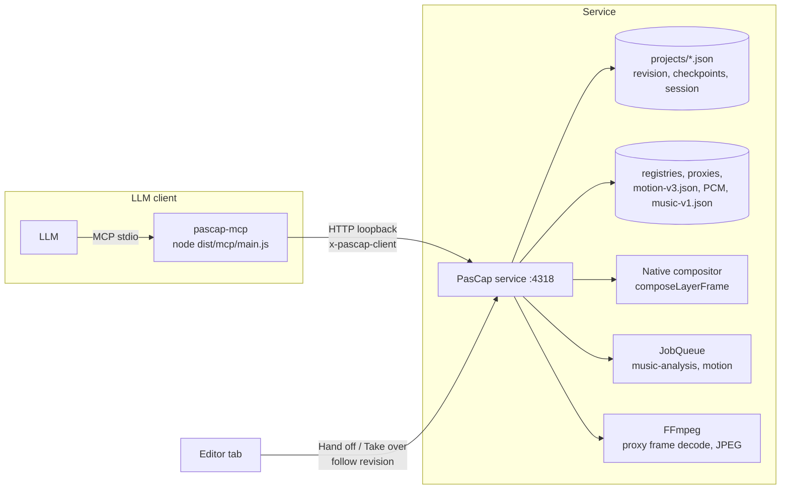

# Assistant rough cut through MCP

**Status: design and delivery plan, not implemented.** Nothing below is a current
contract; the guides it links describe today's behaviour. Phases, routes, tool names and
constants are proposals for the owner to confirm, amend or reject before work starts.

## Goal

The user imports the flight's recordings, makes a first pass (removing whole recordings
from the project and keeping only the interesting parts of the others), chooses a music
recording, then **hands the project off** to an LLM. Through an MCP server the LLM:

1. picks the footage parts worth using, inside what the user kept: it may remove more,
   never add back what the user eliminated;
2. places them on one or more video tracks in a coherent order;
3. sets transitions and fades;
4. grades each track and tunes each clip's Sharpen/Clarity/Denoise, with Auto adjust or
   individual settings;
5. **aligns cuts and transitions with the music**, which needs a new music analysis in
   the service;
6. finishes with a complete project the user reviews and edits in the editor before
   exporting.

While working, the LLM checks its result through stills and contact sheets rendered by
the service from the same compositor as export, plus text summaries of the timeline.

Non-goals: the assistant never imports, relinks, prepares, exports or deletes anything;
it never touches originals; it does not drive the editor's UI; it produces no new
rendering path, schema-less data or defaults. Export, project deletion and real-media
jobs stay with the user.

## What exists today

The plan builds on current code; these are the pieces it reuses or must change.

| Area                 | Today                                                                                                                                                                                                                                                           | Consequence for the plan                                                                                                    |
| -------------------- | --------------------------------------------------------------------------------------------------------------------------------------------------------------------------------------------------------------------------------------------------------------- | --------------------------------------------------------------------------------------------------------------------------- |
| Project document     | Strict Zod schema ([model](../../src/shared/model.ts)); one JSON per project; `PUT /api/projects/:id` with `expectedRevision`, 409 on a stale revision ([storage](../../src/server/storage.ts)); `assertProjectSources` checks registered recordings and ranges | The assistant writes through the same validated save; a concurrent editor tab must stop saving while it works               |
| Edits                | One pure reducer, `applyCommand(document, command)` over the `EditCommand` union ([commands](../../src/shared/commands.ts)): insert/delete/trim/split/place/transition/fades/colour/speed/reverse/transform/detail/music/opacity/keyframes/tracks/bookmarks     | Every assistant edit is an existing command; no second edit vocabulary                                                      |
| Layout               | `calculateLayout()` and `sampleTimeline(project, frame)` ([timeline](../../src/shared/timeline.ts)) give placed clips, transitions and the per-frame `PreviewLayer` list                                                                                        | Text summaries and stills come from the authoritative layout                                                                |
| Native compositor    | `composeLayerFrame()` ([layered-frame](../../src/server/layered-frame.ts)) composes one project frame from per-source RGB8 content into premultiplied RGBA16, CPU pool of ≤ 8 workers; it is the export parity reference                                        | Stills reuse it unchanged                                                                                                   |
| Recordings           | Registry v2 ([media](../../src/shared/media.ts)): metadata, verified 720p proxy (`h264-720p-bt709-gop15-v1`, closed GOP 15), five thumbnails, `damage` ranges; project bin `media.videoIds`/`audioIds`                                                          | The assistant works only on prepared recordings in the bin                                                                  |
| Camera motion        | Background job `motion` writes `motion-v3.json` (per-frame `tx/ty/zoom/rotation`, DJI telemetry); `motionProfile()` and `smoothRanges()` ([motion-analysis](../../src/shared/motion-analysis.ts)); `GET /api/media/:id/motion`                                  | Shot descriptors and steady ranges derive from it, no new decode                                                            |
| Music                | `AudioLibrary` ([audio](../../src/server/audio.ts)) prepares a PCM16 48 kHz stereo cache (`pcm16-48k-stereo-mono-unity-v3`) and a ≤ 2,048-peak waveform; no tempo, beat or structure analysis                                                                   | **New music analysis job** reading that cache                                                                               |
| Auto adjust / AWB    | Pure estimators on RGBA bytes: `analyseAutoAdjust(frames)` ([auto-adjust](../../src/shared/auto-adjust.ts)), `frameIlluminant`/`poolWhiteBalance` ([white-balance](../../src/shared/white-balance.ts)); the editor samples frames with WebCodecs in the browser | The service can run the same estimators on FFmpeg-decoded proxy frames                                                      |
| Detail               | Static clip `detail` with no estimator ([detail filters](DETAIL_FILTERS.md))                                                                                                                                                                                    | A noise/sharpness measurement helper is new                                                                                 |
| First-pass selection | Whole recordings leave the project with **Remove from project**; the Source preview's applied IN/OUT is **browser-local** (`pascap-media-ranges-<project>` in `localStorage`), one range per recording, copied into new clips                                   | The user's kept ranges are invisible to the service: they must move into the project document                               |
| Jobs                 | `JobQueue` runs one heavy task at a time, `motion` in the background after other jobs ([jobs](../../src/server/jobs.ts), [media](../../src/shared/media.ts))                                                                                                    | Music analysis is another background kind; stills are not jobs                                                              |
| Service guards       | Loopback Fastify; every request needs an allowed Host/Origin and non-GET requests the `x-pascap-client` header ([app](../../src/server/app.ts)); 1 MiB body limit                                                                                               | An MCP process is a trusted local client of this API, not a hole in it                                                      |
| Dependencies         | `fastify`, `@fastify/static`, `react`, `react-dom`, `zod` 4 ([package.json](../../package.json)); locked production-license inventory                                                                                                                           | Adding `@modelcontextprotocol/sdk` is a dependency change: risky route, licence inventory update, zod 4 compatibility check |

## Decisions to confirm

| Question                          | Proposal                                                                                                                                                                                                                                                                                                                                                                                                                                           | Why                                                                                                                                                                                                                                                                                       |
| --------------------------------- | -------------------------------------------------------------------------------------------------------------------------------------------------------------------------------------------------------------------------------------------------------------------------------------------------------------------------------------------------------------------------------------------------------------------------------------------------- | ----------------------------------------------------------------------------------------------------------------------------------------------------------------------------------------------------------------------------------------------------------------------------------------- |
| Where the MCP server runs         | A **separate stdio process** (`node dist/mcp/main.js`, `npm run mcp`) that talks to the running service's HTTP API as a client, with `PASCAP_URL` (default `http://127.0.0.1:4318`). Not mounted inside Fastify at first.                                                                                                                                                                                                                          | Every LLM client (Claude Desktop/Code, VS Code, Codex CLI) launches stdio servers; the service keeps its one-writer, loopback and header guards unchanged; the SDK never loads into the service process. A Streamable HTTP mount at `/mcp` with a startup token can come later if needed. |
| Where the user's kept ranges live | New required project field **`selects`**: per recording in the bin, an ordered list of kept source ranges. No entry = the whole recording is available; `[]` is not allowed (remove the recording instead). Schema bump with migration (`selects: {}`) and frozen fixture per [data compatibility](../GITHUB_WORKFLOW.md#data-compatibility).                                                                                                      | The assistant cannot read `localStorage`, and the rule "never add back" needs a server-checkable source of truth. The Source preview's applied range becomes a view of the first select, so the UI change is small.                                                                       |
| How the assistant edits           | New **`POST /api/projects/:id/edits`** `{ commands: EditCommand[], expectedRevision, session }`: the service applies the batch atomically with `applyCommand`, validates like a save and writes one revision. The editor keeps its document saves.                                                                                                                                                                                                 | One validation path and one revision per logical step (the assistant's "one Undo step"); rich command errors come back verbatim; the editor can adopt it later for bulk actions.                                                                                                          |
| Concurrency with the open editor  | A server-side **assistant session** (lease) per project: started from the editor's **Hand off** dialog after flushing autosave, with a **checkpoint** copy of the document. While it holds the lease, editor saves get 423 and the editor follows the document read-only (polling revision); `edits` require the lease. The user can **Take over** at any time; the LLM can `finish_session`. The lease expires after 10 min without MCP activity. | Same project, no silent divergence, nothing destructive: the checkpoint restores the pre-hand-off cut through **Open project file…** (new project) or a **Restore checkpoint** action. A `copy: true` option builds the cut in a new project instead, using the existing import path.     |
| How the LLM sees pictures         | **Native stills** from the proxies through `composeLayerFrame`, encoded to JPEG by FFmpeg, served by new routes; contact sheets tile several stills with a JSON legend. No browser screenshots.                                                                                                                                                                                                                                                    | The composed picture is what matters, it matches export, and it needs no GPU or Chrome. The editor UI is for the user.                                                                                                                                                                    |
| Music analysis                    | A new background job kind (`music-analysis`) on the existing PCM cache: onset envelope, tempo, beats, downbeats, loudness, sections and accents, cached as `music-v1.json`; pure TypeScript in a worker thread, no new dependency or decoder.                                                                                                                                                                                                      | The PCM is already exact 48 kHz stereo; a bounded single-thread analysis takes about a second per song. It also gives the editor beat ticks and **Beats → bookmarks** without the assistant.                                                                                              |
| Export                            | Not exposed.                                                                                                                                                                                                                                                                                                                                                                                                                                       | The user reviews first; export remains a deliberate action with its own storage checks.                                                                                                                                                                                                   |

## Architecture



The MCP process holds no state besides the session token and last known revision. It
converts tool calls into HTTP requests, maps HTTP errors into tool errors and converts
frames to timecode for the model. All analysis, validation and writing happen in the
service.

## Data model changes

### Project `selects` (schema bump)

```ts
selects: Record<mediaId, SelectRange[]>; // SelectRange = { sourceIn, sourceOut }, OUT exclusive
```

- Keys must be in `media.videoIds`; ranges are within the registered frame count, unique,
  ascending, non-overlapping, at least one frame; no empty arrays.
- Removing a recording from the project removes its entry; a clip may use frames outside
  the selects (the user can always do what they want in the editor). Only **assistant
  sessions** are bound: every clip they insert, trim or place must lie inside one select
  of its recording, and a `selects` change they make must be a subset of the previous one
  (`narrow` only). The service enforces this on `edits` with a session.
- Migration: add `selects: {}`. The Source preview keeps its applied IN/OUT; applying a
  range writes it as the recording's single select (one Undo step through a new
  `select-set` command); a later **Keep this range too** adds a second one. Clips still copy
  the applied range as before.

### Assistant session and checkpoint (service files, not schema)

`projects/<id>.assistant.json`: `{ token, startedAt, lastActivityAt, brief, notes, edits }`
written by the service; `projects/<id>.checkpoint-<iso>.json` holds the document as handed
off (bounded to the last 5 checkpoints per project). Neither is part of the project
document, export receipts or compatibility rules.

The **brief** is what the user tells the assistant in the Hand off dialog: chosen music
track or music recording, target length (`follow music` | seconds), style notes (free
text, ≤ 2,000 characters), allowed camera movement (the Source preview tolerance, 0.5–6),
whether speed changes, several tracks and picture-in-picture are allowed, and the maximum
number of clips. It is exposed to the LLM as a resource and never interpreted by the
service.

### Music analysis cache

`audio-assets/<id>/pcm16-48k-stereo-mono-unity-v3/music-v1.json`, tied to the PCM cache
(stored alongside it; removed with it; ignored if the asset's `content` changed):

```ts
{
  version: 1,
  sampleRate: 48000, hop: 480,             // 10 ms feature rate
  tempo: { bpm, confidence },              // global; curve: [{ fromSample, bpm }]
  meter: { beatsPerBar: 3 | 4, confidence },
  beats: [{ sample, strength, downbeat }], // ascending samples
  accents: [{ sample, strength }],         // strong isolated onsets
  loudness: number[],                      // dBFS per 100 ms
  sections: [{ fromSample, toSample, kind: 'quiet' | 'build' | 'peak' | 'release', loudnessDb }]
}
```

Positions are PCM samples; the service converts to music-source frames and project frames
when asked (project frame = `start + (sourceFrame − sourceIn)`, through loops; see
`musicSourceFrame` in [audio](../../src/shared/audio.ts)). Arrays are bounded by song
length: a 10-minute song has about 1,500 beats and 6,000 loudness values.

## Service additions

| Route                                 | Purpose                                                                                                                                                                         | Bounds                                                                                               |
| ------------------------------------- | ------------------------------------------------------------------------------------------------------------------------------------------------------------------------------- | ---------------------------------------------------------------------------------------------------- |
| `POST /api/projects/:id/assistant`    | Start a session: checkpoint, brief, lease token; refuses when a session is active, recordings in the bin are not ready, or autosave is dirty (the editor flushes first)         | One session per project                                                                              |
| `GET /api/projects/:id/assistant`     | Session status, brief, edit log, notes (editor banner and LLM resource)                                                                                                         |                                                                                                      |
| `DELETE /api/projects/:id/assistant`  | End or take over; keeps notes                                                                                                                                                   |                                                                                                      |
| `POST /api/projects/:id/edits`        | Apply a batch of `EditCommand`s atomically; with a session token it also enforces selects and bin membership; returns the saved document or the first failing command's message | ≤ 64 commands per batch, 1 MiB body as today                                                         |
| `POST /api/projects/:id/still`        | One composed project frame from the proxies (`{ document?, frame, width ≤ 1280, crop? }`), JPEG                                                                                 | Serial, one FFmpeg child at a time, two waiting; refused (409) while an export or reference job runs |
| `POST /api/projects/:id/sheet`        | Contact sheet of ≤ 12 project frames (explicit list, or `from/to/count`), JPEG plus legend                                                                                      | Same as still                                                                                        |
| `GET /api/media/:id/frame/:frame`     | One proxy source frame as JPEG (`width ≤ 1280`), for looking at footage before placing it; `sheet` variant for a source range                                                   | Same as still                                                                                        |
| `GET /api/media/:id/shots?tolerance=` | Shot descriptors from `motion-v3.json` (below); 409 with the job when analysis is missing or running                                                                            | Computed on request, no cache                                                                        |
| `POST /api/media/:id/estimate`        | `{ sourceIn, sourceOut, kind: 'auto-adjust' \| 'white-balance' \| 'detail' }`: decodes ≤ 16 proxy frames at ≤ 320 × 180 and runs the shared estimators or the detail heuristics | Serial with stills                                                                                   |
| `POST /api/audio/:id/analyse`         | Queue the music analysis job; `GET /api/audio/:id/analysis` returns `{ analysis, job }`                                                                                         | Background job kind                                                                                  |
| `POST /api/projects/:id/beats`        | Helpers over the saved document: `alignment` report, `snap-cuts` proposal/apply, `beats-to-bookmarks`                                                                           | Pure, bounded by clip/beat counts                                                                    |

### Stills and contact sheets

Pipeline for project frame $f$:

1. `sampleTimeline(document, f)` (and `sampleSlots` for transition timeslots) gives the
   active sources with evaluated Colour, Transform, Detail, weights and Opacity.
2. For each source, decode proxy frame `sourceFrame` with FFmpeg: `-ss` to the keyframe at
   or before it (closed GOP 15, uniform 1001/30000 durations), `select` the exact frame,
   output `rgb24`, verify exactly one frame. Damaged ranges follow the proxy, which is
   already black there.
3. `composeLayerFrame` composes the group(s) at proxy size into the RGBA16 accumulator
   (bottom-to-top source-over as export does, see
   [group composition](../LAYERS_AND_KEYFRAMES.md#group-composition)).
4. Flatten over opaque black, scale to the requested width, encode JPEG (quality 80) with
   FFmpeg from raw input; sheets copy each still into a grid before one encode and return a
   legend `{ cell, frame, timecode, clipIds }` instead of burnt-in text (no libfreetype
   dependency).

An optional `document` in the body previews a candidate before saving it, so the LLM can
compare a grade or a transition without a revision; it is validated exactly like a save.
Default size 640 × 360 (about 50 KB); a `crop` at 1:1 proxy pixels serves judging Sharpen
and Denoise. Stills show the 720p proxy composition: the export at 4K differs in
resolution only, as the preview does today ([detail filters](DETAIL_FILTERS.md#kernel)).
A 720p frame composes in well under a second on the CPU pool; the GPU worker is not used.

### Shot descriptors

Derived per recording from the motion analysis and telemetry, without decoding:

- the steady ranges at the brief's tolerance (`smoothRanges`), each with duration, mean
  and peak camera speed, roughness, a motion class (`static`, `pan left/right`,
  `tilt up/down`, `push in/out`, `orbit`, `mixed`, from the sign and share of
  `tx`/`ty`/`zoom`/`rotation`), and telemetry means (height, distance, horizontal and
  vertical speed) where present;
- recording-level facts: duration, damage, hovering shares, telemetry extremes, file name;
- optional picture facts from the five thumbnails (mean luma, colourfulness through
  `toneStatistics`), cheap and already decoded.

They are intersected with the project's `selects`, so the LLM only ever sees usable
ranges.

### Server-side Auto adjust, white balance and detail measurement

`POST /api/media/:id/estimate` decodes the frames `autoAdjustFrames(sourceIn, sourceOut)`
(or the white-balance window) from the proxy, scaled to at most 320 × 180 with a bilinear
scaler, to RGBA and runs the unchanged estimators. The browser samples through a canvas, so pixels differ
slightly from FFmpeg's scaler: the results agree within tolerance but are not bit-identical
with **Auto** in the editor; the unit test fixes that tolerance. The LLM applies the
result through the existing `colour` command, scaled by the same `scaleCorrection` and
intensity rule ([Auto adjust](AUTO_ADJUST.md)); animated settings are reported and left
alone, like the popover does.

Detail has no estimator today. The `detail` kind returns measurements, not settings: noise
level (median absolute high-pass residual in flat 8 × 8 blocks, in 8-bit codes), sharpness
(gradient energy at the proxy scale) and compression blockiness, each with a suggested
starting value (Denoise from noise above about 1.5 codes; Sharpen 0.2–0.5 by sharpness;
Clarity 0–0.2). They are heuristics the LLM confirms on 1:1 crops; they are kept in one
module with their constants, like `AUTO_ADJUST`, so the owner can tune them on real
flights.

## Music analysis

Runs in a worker thread (as `motion-pool` does), streaming the PCM cache in 1 MiB blocks,
mono downmix in float; no new dependency (a small radix-2 FFT in TypeScript).

| Stage          | Method                                                                                                                                                                                                                                                |
| -------------- | ----------------------------------------------------------------------------------------------------------------------------------------------------------------------------------------------------------------------------------------------------- |
| Features       | 2,048-sample Hann window, hop 480 (100 Hz); 40 triangular bands 30 Hz–16 kHz, log compression                                                                                                                                                         |
| Onset envelope | Half-wave rectified spectral flux summed over bands, smoothed, normalised; 12-bin chroma-lite per frame for structure                                                                                                                                 |
| Tempo          | Autocorrelation of the envelope over 8 s windows with a log-normal prior centred at 120 BPM, candidates 50–220 BPM (Ellis 2007); global tempo and a per-window curve; octave errors resolved towards the prior; confidence from the peak's prominence |
| Beats          | Dynamic-programming beat tracking on the envelope at the local tempo, refined to the nearest onset peak within ±20 ms; `strength` from the envelope                                                                                                   |
| Downbeats      | Among 4 (then 3) phases, the one maximising mean onset strength plus low-band energy at candidate downbeats; `meter` with a confidence; a heuristic the LLM may ignore                                                                                |
| Loudness       | RMS per 100 ms in dBFS                                                                                                                                                                                                                                |
| Sections       | Novelty from a checkerboard kernel over the self-similarity of 1 s band-energy and chroma averages; boundaries at prominent peaks with sections ≥ 8 s; kinds from relative loudness and slope (`quiet`, `build`, `peak`, `release`)                   |
| Accents        | Envelope peaks above the 90th percentile at least 150 ms apart: hits worth cutting on                                                                                                                                                                 |

Bounds: features for a 10-minute song are 60,000 × 40 floats (about 10 MB) and the PCM is
never held whole; one analysis at a time, in the background after other jobs, cancellable,
tied to the PCM cache's identity like `motion-v3.json` is to the proxy's `verifiedAt`.
Missing analysis for an older cache shows an explicit **Analyse music** action; nothing is
rewritten silently.

Validation uses synthetic signals only: click tracks and amplitude-modulated noise at
60–200 BPM with offsets, swing, a tempo change and added noise; beats within ±35 ms
(about one project frame) at F-measure ≥ 0.95, tempo within 2 % (or its double/half
flagged), downbeats ≥ 0.8 on accented bars, sections at synthetic loudness steps;
deterministic results; a loop-placed music track maps beats to project frames across the
wrap. Real songs are evaluated by the owner, not by CI.

Editor value independent of the assistant: beat ticks (downbeats stronger) on each music
lane from its analysis, and **Beats → bookmarks** in **Audio → Music** (all beats or
downbeats only, within the music track's placement) adding at most 1,000 bookmarks in one
Undo step, after which every snapping gesture lands on the beat
([bookmarks](../TIMELINE_EDITING.md#bookmarks)). A 3-minute song at 120 BPM is 360
beats; the action reports when it would exceed the limit and offers downbeats only.

### Alignment helpers

`POST /api/projects/:id/beats`:

- `alignment`: for every boundary of every video track, the moment the viewer perceives
  (cut frame; middle of a dissolve; middle of a black pause), the nearest beat and
  downbeat with signed offsets in frames, and a summary (share of boundaries within one
  frame of a beat). Also the first and last video frame against the music's first/last
  beat and sections.
- `snap-cuts`: on one Ripple track, shorten clips' OUT (or IN) inside their selects so each
  boundary lands on the nearest beat or downbeat at or before its current position,
  keeping each clip at least `minimumFrames` long and honouring existing dissolve
  overlaps; returns the resulting `trim` commands as a proposal (`dryRun: true`) or applies
  them as one batch. Deterministic arithmetic the LLM should not do by hand.
- `beats-to-bookmarks`: the editor action above, for the LLM.

## MCP server

Package: `src/mcp/` built by `tsconfig.server.json` into `dist/server/mcp`, started with
`npm run mcp` (`node dist/server/mcp/main.js`). Configuration: `PASCAP_URL`
(default `http://127.0.0.1:4318`), `PASCAP_PROJECT` (optional default project). It sends
`x-pascap-client: assistant` (added to the accepted values) on every request. The LLM
client configuration is one line, for example in VS Code:

```json
{ "servers": { "pascap": { "type": "stdio", "command": "node", "args": ["dist/server/mcp/main.js"] } } }
```

Conventions: frames are authoritative and every output also carries `MM:SS:FF` timecode
(30 fps NDF, as the editor shows); inputs accept either. Every write returns the new
revision and a one-line summary. Validation failures are tool errors with the service's
message (for example an overlap or an invalid fade), never exceptions. Large outputs are
paged (`offset`/`limit`) and summarised by default; the LLM asks for detail.

### Resources

| URI                              | Content                                                                                                                                                |
| -------------------------------- | ------------------------------------------------------------------------------------------------------------------------------------------------------ |
| `pascap://session`               | Session state, brief, elapsed time, edit count, last notes                                                                                             |
| `pascap://project`               | Compact timeline: tracks (name, Ripple, fades, Colour summary, Transform summary), clips with timecodes, transitions, music tracks, bookmarks, selects |
| `pascap://recordings`            | Bin recordings: id, name, duration, frames, damage, selects, telemetry summary, analysis availability                                                  |
| `pascap://recordings/{id}/shots` | Shot descriptors at the brief's tolerance                                                                                                              |
| `pascap://music/{id}/analysis`   | Tempo, meter, sections, beat count, accents; beats on request                                                                                          |
| `pascap://guide`                 | The assistant playbook below, so the client needs no custom system prompt                                                                              |

### Tools

Read and analysis (no revision change):

| Tool                 | Input                                                    | Output                                                                                 |
| -------------------- | -------------------------------------------------------- | -------------------------------------------------------------------------------------- |
| `describe_project`   | `detail: 'summary' \| 'full'`                            | Text table of the timeline, duration, music, alignment summary                         |
| `describe_recording` | `mediaId`, `tolerance?`                                  | Shots, steady ranges inside selects, telemetry, damage                                 |
| `recording_sheet`    | `mediaId`, `sourceIn`, `sourceOut`, `count ≤ 12`         | Contact sheet image + legend                                                           |
| `source_frame`       | `mediaId`, `frame`, `width?`, `crop?`                    | One proxy frame image                                                                  |
| `still`              | `frame`, `width?`, `crop?`, `document?`                  | Composed project frame image (optionally of a candidate document)                      |
| `timeline_sheet`     | `from`, `to`, `count ≤ 12` or `frames[]`                 | Contact sheet of the timeline + legend                                                 |
| `music_analysis`     | `mediaId`, `window?`                                     | Tempo, sections, beats/accents in the window as samples, source frames, project frames |
| `check_alignment`    | —                                                        | Boundary-to-beat report                                                                |
| `estimate`           | `clipId`, `kind: auto-adjust \| white-balance \| detail` | Suggested values with confidence and the frames used                                   |
| `preview_edits`      | `commands[]`                                             | Dry run: the resulting timeline summary and errors, no save                            |

Write (each call is one revision, one Undo step for the user):

| Tool                 | Input                                                                     | Notes                                                                                 |
| -------------------- | ------------------------------------------------------------------------- | ------------------------------------------------------------------------------------- |
| `edit`               | `commands: EditCommand[]`                                                 | The generic path; the same union as the editor, validated server-side                 |
| `add_clip`           | `mediaId`, `sourceIn`, `sourceOut`, `layerId?`, `start?`, `after?`        | Builds `insert`/`place`; refuses frames outside selects or recordings outside the bin |
| `trim_clip`          | `clipId`, `sourceIn?`, `sourceOut?`                                       | `trim`; selects enforced                                                              |
| `remove_clip`        | `clipId`                                                                  | `delete`                                                                              |
| `set_transition`     | `leftId`, `rightId`, `type`, `duration?` / `fade?`, `pause?`              | `transition`; same-track adjacency rules apply                                        |
| `set_fades`          | `layerId`, `opening`, `closing`                                           | `fades`                                                                               |
| `set_music`          | `music: MusicTrack[]`                                                     | `music`; only recordings in `audioIds`                                                |
| `set_colour`         | `layerId`, partial Colour settings or `autoAdjust: { clipId, intensity }` | `colour`; animated settings skipped and reported                                      |
| `set_detail`         | `clipId`, `sharpen?`, `clarity?`, `denoise?`                              | `detail`                                                                              |
| `set_speed`          | `clipId`, `rate` or keyframes, `reverse?`                                 | `speed`/`reverse`; refused when the brief forbids speed changes                       |
| `set_transform`      | `layerId`, base pose fields                                               | `transform`; refused when the brief forbids picture-in-picture                        |
| `add_track`          | `name`, `ripple?`                                                         | `layer-add`; refused when the brief forbids several tracks                            |
| `snap_cuts_to_beats` | `layerId`, `prefer: beat \| downbeat`, `minimumSeconds`, `apply`          | The alignment helper                                                                  |
| `add_bookmarks`      | `frames[]` or `fromBeats: { musicId, downbeatsOnly }`                     | `bookmark-add` batch                                                                  |
| `narrow_selects`     | `mediaId`, `ranges[]`                                                     | Subset only                                                                           |
| `checkpoint`         | `label`                                                                   | A named checkpoint the user can restore                                               |
| `finish_session`     | `notes`                                                                   | Ends the lease; the notes appear in the editor's hand-off dialog                      |

Keyframes are reachable only through `edit` (`layer-key-*`), deliberately without
wrappers: the playbook asks for static grades unless the brief wants animation.

### Guards

- No tool takes a filesystem path, imports, prepares, relinks, exports, deletes a project
  or removes a recording from the project.
- Session required for every write; the lease token never reaches the LLM (the MCP
  process holds it). A take-over or expiry ends the session: later writes fail with
  "The user took the project back."
- Selects and bin membership are enforced in the service, not only in the MCP process.
- Image responses are at most 1 MB each; stills and estimates are serialised and refused
  during exports; the service applies the same 120 s request timeout as today.
- Every batch is validated like a save (`projectSchema`, layout, `assertProjectSources`).

## Hand-off in the editor

1. **Hand off** (header, beside Export) opens a dialog: music (a placed music track, or a
   ready music recording to place at frame 0), target length, allowed camera movement,
   permissions (speed, several tracks, picture-in-picture), notes, and a readiness list:
   every bin recording prepared and analysed, the music prepared and analysed (queue the
   missing jobs from the dialog and wait), autosave clean, no running export.
2. Confirm flushes autosave, writes the checkpoint and starts the session. The editor
   enters **follow mode**: a banner "Assistant is editing · N edits · last: …" with
   **Take over**; controls are read-only; the document reloads on each new revision
   (polling `GET /api/projects/:id` about once per second, with the preview following the
   last edited frame); history is cleared on take-over like a project switch.
3. **Take over**, `finish_session` or expiry returns to normal editing on the latest
   revision. The dialog then shows the assistant's notes, the edit log and **Restore
   checkpoint** (replaces the document in one revision; the current state is checkpointed
   first) beside **Open checkpoint as new project**.
4. The MCP client is started by the user outside PasCap (its own window); the dialog shows
   the one-line client configuration and whether an MCP process has connected.

Keyboard, focus and Undo contracts of the editor are unchanged outside follow mode; follow
mode is a new read-only state tested like a disabled preview.

## Assistant playbook (the `pascap://guide` resource)

The LLM is told what good looks like and what PasCap can do; the tools do the arithmetic.

1. **Read** the session brief, the project and the recordings. Note the music's tempo,
   sections and length; decide the target duration (music length unless the brief says
   otherwise; the music fades out if the cut is shorter).
2. **Select**: for each recording, read its shots inside the selects; look at a contact
   sheet of each candidate steady range; keep the strongest ranges (composition, light,
   movement that completes within the range) and narrow selects for the rest. Prefer
   whole camera movements over fragments; avoid damaged and hovering stretches.
3. **Structure**: order shots to tell the flight (chronological or by place, wide
   establishing shots at section starts, the most dramatic movement on the music's peak,
   calm shots in quiet sections); plan clip lengths from the sections and the beat grid
   (longer clips on slow music, cuts on downbeats at peaks). Use a second track only for
   deliberate overlays the brief allows.
4. **Build** on one Ripple track with `add_clip` in order, then `snap_cuts_to_beats`;
   check `check_alignment` and a `timeline_sheet` around each boundary. Set transitions:
   cuts on beats, short dissolves (8–15 frames) between related shots, fade through black
   between sections, opening and closing fades matching the music's fade.
5. **Grade**: per track, `estimate auto-adjust` on a representative clip and apply at
   80 %; compare `still`s of two or three frames per clip before and after; adjust
   Temperature/Tint or Exposure per track when shots differ, moving a clip to its own
   track if it needs its own grade. Set Detail per clip from `estimate detail`, verified
   on a 1:1 crop (no halos, no waxy denoise).
6. **Verify**: a full `timeline_sheet`, the alignment report, the duration against the
   target, every clip inside its selects, music fades; then `finish_session` with notes
   naming the structure, the choices and anything the user should look at.

## Delivery plan

Each phase is one or more issues; routes follow [the workflow](../GITHUB_WORKFLOW.md).
Persisted formats, service routes and the new dependency are risky (PR with
auto-merge); editor UI and docs are routine.

| Phase | Work                                                                                                                                                                    | Route          | Validation                                                                                                                                                           |
| ----- | ----------------------------------------------------------------------------------------------------------------------------------------------------------------------- | -------------- | -------------------------------------------------------------------------------------------------------------------------------------------------------------------- |
| 0     | Project `selects` (schema bump, migration, fixture, `select-set`/`select-narrow` commands), Source preview applies to selects, **Keep this range too**                  | Risky (schema) | Unit: schema/migration/commands; browser: source range round trip; fixture compatibility                                                                             |
| 1     | Music analysis job, cache, routes, beat ticks on music lanes, **Beats → bookmarks**                                                                                     | Risky (format) | Unit: synthetic beat/tempo/section gates, worker bounds, cancellation; browser: ticks and bookmarks action; `test:media` for the PCM reader                          |
| 2     | `edits` batch route, assistant session/lease/checkpoint, editor **Hand off**/follow mode/**Take over**/**Restore checkpoint**                                           | Risky (routes) | Unit: lease, 423/409 paths, atomic batch, selects enforcement; browser: hand-off dialog, follow mode, take-over, restore                                             |
| 3     | Stills, sheets, source frames, shot descriptors, `estimate` (Auto adjust/AWB/detail), alignment helpers                                                                 | Risky (native) | Unit: still equals the layered-export frame for the same project (same compositor), sheet legend, estimator tolerance against the browser path, snap-cuts arithmetic |
| 4     | MCP process: SDK dependency and licence inventory, tools/resources/guide, error mapping, `npm run mcp`, docs (USER_GUIDE, DEVELOPMENT, this guide becomes the contract) | Risky (deps)   | Unit: in-memory MCP client runs a scripted session end to end against a memory service; a deterministic "fake LLM" script exercises every tool; no real model in CI  |
| 5     | Owner evaluation on real flights (consent): playbook and heuristic tuning, image budgets, timings; decide Phase 2 of Auto adjust interplay                              | —              | Evidence in the issue, not CI                                                                                                                                        |

Phases 1 and 3 are independent of the MCP and useful on their own; Phase 0 unblocks the
"never add back" rule and should land first. Phase 4 cannot start before 2 and 3.

Docs to update when each phase lands: [TIMELINE_EDITING](../TIMELINE_EDITING.md)
(selects, beats as bookmarks), [SPEED_AND_AUDIO](../SPEED_AND_AUDIO.md) (music analysis
and cache), [WORKSPACE_AND_RECOVERY](../WORKSPACE_AND_RECOVERY.md) (hand-off, follow
mode, checkpoints), [DEVELOPMENT](../DEVELOPMENT.md) (routes, `npm run mcp`, resource
bounds), [USER_GUIDE](../USER_GUIDE.md), [DEPLOYMENT](../DEPLOYMENT.md) (the MCP process
and loopback), [EDITOR_CONTROLS](EDITOR_CONTROLS.md) (new controls) and the
[README index](../README.md).

## Open questions for the owner

1. Same project with a lease and checkpoint (proposed) or always a copy?
2. Should the assistant be allowed to create tracks, use Transform overlays and speed
   changes by default, or only when the brief allows (proposed: brief flags, all off
   except several tracks)?
3. Which LLM client first (VS Code, Claude Desktop/Code, Codex CLI)? All use stdio; the
   dialog's configuration snippet targets the first one.
4. Do the user's first-pass ranges also need **exclusions** (ranges to avoid inside a
   kept range), or are several kept ranges enough (proposed)?
5. Should `Beats → bookmarks` and beat ticks ship before anything assistant-related
   (proposed: yes, Phase 1 is user-facing on its own)?
6. Image budget: default 640 × 360 and 12-cell sheets, or smaller to save tokens?

## Risks and limits

- Beat tracking is weakest on ambient or rubato music; low confidence is reported and the
  playbook falls back to sections and loudness. Downbeats and sections are heuristics.
- The LLM's cost is dominated by images; the text summaries, sheets and the alignment
  helper exist to keep iterations cheap. Long sessions should checkpoint.
- Server-side Auto adjust agrees with the editor's within a tolerance, not exactly, because
  the browser and FFmpeg scale differently.
- Stills are proxy-resolution compositions; fine detail at 4K is judged at export, as in
  the preview today.
- The MCP SDK is a new production dependency: its zod 4 compatibility, licence and size
  must be checked before Phase 4; the MCP process never runs inside the service.
- Follow mode polls; a long assistant session keeps the tab's preview decoding on each
  revision. The interval and the "jump to last edit" behaviour need live checks.
- Nothing here changes rendering, export routing, resource budgets or the proxy/PCM
  formats; the schema bump adds one field with an empty migration default.
