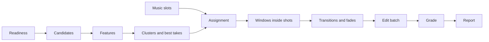

# Auto edit (proposal)

**Status: proposal for the owner, not a contract.** It asks whether PasCap can build a good-enough
first cut **without an LLM**: one deterministic algorithm that chains the analyses PasCap already
has (steady ranges and shot kinds, flight data, kept ranges, music analysis, snapping, Auto, Match)
into shot selection, ordering, cut lengths on the music, transitions, fades and grading. Nothing
here is implemented.

## Goal

From the same starting point as **Hand off** (recordings prepared and analyzed, the user's kept
ranges, a music recording), the user presses **Auto edit**, waits a few seconds, and gets a complete
cut on one Ripple track: shots chosen inside the kept ranges, near-duplicate takes removed, ordered
like the flight, cut on downbeats and strong hits with lengths following the music's sections,
transitions and fades, and one grade per clip made consistent across the cut. The user reviews and
edits it like any cut, as one Undo step.

Why it is worth building next to the assistant:

- **No client, model, token or picture budget.** Run 2 of [#243](https://github.com/Plonk42/PasCap/issues/243)
  stopped at the client's 20-picture limit; an algorithm needs none.
- **Seconds, deterministic, repeatable.** The same project and brief give the same cut; a tuning
  change is measurable on fixed flights.
- **A better starting point for the assistant.** An `auto_edit` operation gives the LLM a sound cut
  to judge and refine with a few pictures, instead of building from scratch.
- Most of the "craft" rules in the [assistant guide](../../src/server/assistant-guide.ts) are already
  mechanical: whole camera movements, establishing shot first, calm shots in quiet sections, cuts on
  downbeats, 2–8 beats per clip, dissolves with `keepCut`, fades in silences, Auto then Match.

Non-goals: no import, preparation, export or deletion (like the assistant); no new rendering path;
no change to originals; no schema change for the first phases (the result is ordinary edit commands).

## What exists and what auto edit reuses

| Area            | Today                                                                                                                                                                                                                                     | Auto edit use                                                                                                                   |
| --------------- | ----------------------------------------------------------------------------------------------------------------------------------------------------------------------------------------------------------------------------------------- | ------------------------------------------------------------------------------------------------------------------------------- |
| Kept ranges     | Project `selects` per recording; clips must stay inside them in sessions ([selects](../../src/shared/selects.ts))                                                                                                                         | Hard limit of every candidate                                                                                                   |
| Steady ranges   | `smoothRanges(motionProfile)` within `SteadyLimits` (jolts, movement, flight speed), damage excluded ([motion analysis](../../src/shared/motion-analysis.ts))                                                                             | Candidate shots                                                                                                                 |
| Shot descriptor | `recordingShots`: camera move name, `kind` (orbit, reveal, move, approach, static), `rank`, mean/peak speed, jolts, flight means (height, speeds, distance), still share ([recording shots](../../src/shared/recording-shots.ts))         | Candidate features, quality and energy                                                                                          |
| Telemetry       | Per-second DJI subtitles: speeds, height, distance from home, ISO, shutter, EV, digital zoom                                                                                                                                              | Energy, "establishing" shots (high, far), exposure risk (high ISO)                                                              |
| Music analysis  | Tempo and curve, meter, beats/downbeats with strength, hits (band, strong), loudness per 100 ms, tone per s, key, silences, swells, sections (`quiet`, `build`, `peak`, `release`) ([music analysis](../../src/shared/music-analysis.ts)) | The cut's time grid: slot boundaries, slot lengths, slot energy, transitions, fades                                             |
| Alignment       | `snapCutsToBeats` (nearest beat/downbeat/hit, lengthening inside kept ranges, `keep`, `maxShift`) and `check_alignment` ([beat alignment](../../src/shared/beat-alignment.ts))                                                            | Safety pass and the report's alignment metrics                                                                                  |
| Edits           | `editCommandSchema` + `applyCommand`; batch `edit` with `expectedRevision`; `preview_edits`; transitions with `keepCut`; track fades; `layer-create`                                                                                      | The output is one command batch                                                                                                 |
| Grading         | `estimate`: auto-adjust (`applyAs: shots` writes one clip grade per clip), white balance, detail, `match` to a hero frame or a registered style ([estimate](../../src/server/operations/estimate.ts), [Color match](COLOR_MATCH.md))      | Per-shot correction, then one look across the cut                                                                               |
| Scene likeness  | `frameSimilarity` (correlation of coarse log-luma layouts, robust to exposure and white balance) and `sceneLikeness` ([look match](../../src/shared/look-match.ts))                                                                       | Near-duplicate takes                                                                                                            |
| Frame access    | Still renderer's serial queue decodes exact proxy frames (about 2 s for 16 frames at analysis size); the motion job decodes **every** proxy frame at 320 × 180 gray                                                                       | Picture features per candidate                                                                                                  |
| Sessions        | Lease, checkpoint, brief (notes, music track, target length, steady limits, most clips, style), Hand off dialog with readiness actions ([assistant session](../../src/shared/assistant-session.ts))                                       | Same brief and readiness; the assistant can call auto edit inside its session                                                   |
| Registry        | One operation definition gives the HTTP route, the MCP tool and the web client ([operations](../../src/shared/operations/index.ts))                                                                                                       | One `auto_edit` operation for the editor and the assistant (the lesson of [#328](https://github.com/Plonk42/PasCap/issues/328)) |

## What the LLM does today that an algorithm must replace

| LLM judgment                                  | Algorithmic substitute                                                                                                                                         | Quality expected                                                                                                                                   |
| --------------------------------------------- | -------------------------------------------------------------------------------------------------------------------------------------------------------------- | -------------------------------------------------------------------------------------------------------------------------------------------------- |
| Which of several similar takes is best        | Cluster candidates by scene likeness of their frames, flight data and capture order; keep the best-scored one per cluster                                      | Good: takes of one subject are similar in layout; risk of merging two subjects with similar terrain                                                |
| Composition, subject, light                   | Not measured. Proxies: steadiness, movement kind, flight speed and height, exposure clipping, contrast and colorfulness of the analysis frames, blur, high ISO | Weakest point: no subject detection (owner, 2026-10-21: PasCap does no pattern recognition)                                                        |
| Story order                                   | Flight order (capture time, else file name), with the establishing shot first and the strongest movement on the peak                                           | Good for drone flights, which are a journey                                                                                                        |
| Pace and structure from the music             | Slots built on sections, downbeats and strong hits, lengths by section kind and tempo                                                                          | As good as the music analysis (weak meter confidence on some songs)                                                                                |
| Where a shot starts and ends inside its range | Window choice inside the steady range: whole movement when it fits, else the part that keeps the movement's payoff (end of a reveal, middle of an orbit)       | Fair                                                                                                                                               |
| Grade judgment                                | Auto per shot, then Match to a hero or to the brief's style; never animate                                                                                     | As good as Auto and Match today ([#313](https://github.com/Plonk42/PasCap/issues/313), [#318](https://github.com/Plonk42/PasCap/issues/318) apply) |
| The brief's free-text notes                   | Not interpreted. A few structured choices instead (pace, order, transitions, grade)                                                                            | Explicit and predictable                                                                                                                           |

The honest summary: an algorithm can do the **mechanical 80 %** (selection by measurable quality,
deduplication, ordering, music fit, transitions, consistent grade); it cannot see that a shot shows
the summit cross or that a frame is badly framed. The user, or the assistant with a handful of
pictures, judges that afterwards.

## Pipeline

Every stage is a pure function in `src/shared/auto-edit/` on plain data (motion analyses, music
analyses, project document, picture features), so it is unit-tested on synthetic inputs and runs
the same in the service and in tests. Only frame decoding and the grade estimate run in the service.
All constants live in one frozen `AUTO_EDIT` object, like `AUTO_ADJUST` and `LOOK_MATCH`.

### 1. Readiness

Same checks as `hand_off_readiness`: every recording in the bin prepared and motion-analyzed, the
chosen music prepared and analyzed. A recording without motion analysis is left out and reported
rather than blocking. The target length is the brief's `targetSeconds`, else the music clip's
length, else the length the footage supports at the chosen pace.

### 2. Candidates

For each recording in the bin, `recordingShots(analysis, damage, kept, limits, fps)` gives the
steady ranges inside the kept ranges within the brief's steady limits, each with its kind, rank,
speeds, jolts and flight means. A candidate is one such range with:

- its usable length $L$ and the shortest useful window (`AUTO_EDIT.minimumSeconds`, about 1.5 s);
- its source order key: capture time when known, else the natural sort of the file name (DJI names
  are sequential), then its source IN;
- a **movement profile**: per-frame speed from `motionProfile`, used later to place the window.

Hovering stretches (`static` kind) stay candidates with a low weight: a still establishing view on a
quiet intro can be right.

### 3. Features

Motion and flight features come from the caches, without decoding:

- **kind weight** $w_k$ (`SHOT_WEIGHTS`), **steadiness** $s = 1 - \min(1, \text{jolts}/\text{maxJolts})$;
- **energy** $e \in [0, 1]$: percentile of the mean picture speed among all candidates, blended with
  the flight speed's percentile and a kind bonus (orbit, reveal high; static low);
- **establishing**: a reveal or a high, far, slow shot (height and distance percentiles);
- **completeness**: whether the range holds one whole movement (the speed profile ramps up and down
  inside it) rather than a fragment cut by a jolt.

Picture features need frames. Phase 2 decodes three frames per candidate (at 1/6, 1/2 and 5/6 of
the range) on the still renderer's queue at the analysis size, as `estimate` does, and measures:

- **exposure risk**: share of clipped highlights and crushed shadows (the Auto statistics);
- **contrast and colorfulness** (as `measureLook` does), low values meaning haze or flat light;
- **blur** (the detail estimate's softness measure);
- the **layout descriptor** of `frameSimilarity` for clustering.

Cost: three frames at about 0.13 s each is about 0.4 s per candidate, so 30–60 s for 100 candidates.
If that is too slow, the motion job, which already decodes every frame at 320 × 180 gray, could
store a per-second luma layout and histogram (a regenerable cache version, explicit re-analysis);
it lacks color, so colorfulness would still need decoded frames. Measure before choosing.

The **quality** of a candidate combines them; the shape follows `shotScore` (weight times length up
to a cap) with multiplicative penalties, so an unmeasured feature changes nothing:

$$q = w_k \cdot \min(L, L_{\text{cap}}) \cdot s^{a} \cdot (1 - \rho_{\text{exposure}})^{b} \cdot (1 - \rho_{\text{blur}})^{c} \cdot (1 + d \cdot \text{completeness})$$

### 4. Clusters and best takes

Flights hold several takes of one subject. Two candidates are **alike** when their frames' best
`frameSimilarity` is above a threshold, and the threshold is lowered when their flight means
(height, distance from home) are close and they are near in capture order. Agglomerative clustering
(single link on this graph, bounded cluster span in capture order) groups them; each cluster keeps
its best-quality candidate, and the next best only when the cut has more slots than clusters.
Two candidates of the same recording that overlap are always one cluster.

This is the main use of pictures and the main risk: snowfields or forests can look alike in layout.
Flight data and capture distance guard against merging distant subjects; the report lists every
cluster so the user sees what was considered a duplicate.

### 5. Music slots

The music decides the time grid; footage then fills it. Slots are built along the music clip,
section by section:

1. **Forced boundaries**: section starts (already moved onto downbeats by the analysis), sudden
   swells, the start and end of silences.
2. **Desired length per section kind**, in beats at the section's tempo, scaled by the brief's pace
   (calm × 1.5, energetic × 0.6) and clamped to seconds bounds:

   | Section   | Beats per clip | Notes                                    |
   | --------- | -------------- | ---------------------------------------- |
   | `quiet`   | 8 (two bars)   | Long, calm shots; dissolves allowed      |
   | `build`   | 8 → 4          | Lengths shrink towards the section end   |
   | `peak`    | 2–4            | Cuts on downbeats, strong hits preferred |
   | `release` | 8              | Slower again; the closing shot holds     |

3. **Boundaries in between**: walking from the section start, the next boundary is the downbeat
   (else beat, else strong hit) whose distance is closest to the desired length; a strong hit within
   one beat of it wins. Without a steady beat (`tempo` null), strong hits are the grid, else even
   lengths in seconds.
4. **Slot energy** $E \in [0, 1]$: the section's loudness percentile, its high-band tone and the kind
   (`peak` high, `quiet` low).

The slots end where the cut ends: at the target length, rounded to the music's last downbeat or
section end before it, so the music can close with a fade there. If the footage cannot fill the
target, slots are lengthened (more beats each) before the target is shortened; the report says so.

### 6. Assignment

Shots are assigned to slots by dynamic programming, like sequence alignment: slots in time order,
candidates in flight order, each candidate used at most once, candidates may be skipped, slots may
not. With flight order on, the chosen candidates are increasing in capture order; with order
"energy arc", order is free and the problem becomes a bipartite assignment (Hungarian) plus a
diversity pass.

The score of candidate $i$ in slot $j$:

$$S(i, j) = q_i \cdot \text{fit}(L_i, \ell_j) - \alpha \lvert e_i - E_j \rvert - \beta\,[\text{kind}_i = \text{kind}_{\text{prev}}] + \gamma\,[\text{establishing}_i \wedge j \text{ opens a section}]$$

- $\text{fit}$ is 1 when the candidate holds the slot length $\ell_j$ as a whole movement, falls
  when the slot would cut it to a fragment, and is 0 when the candidate is shorter than $\ell_j$
  (Phase 6 may slow high-frame-rate footage to fill it);
- the strongest orbit or reveal tends to land on the peak through the energy term, the establishing
  shot on the first slot and section starts through the bonus;
- the brief's `maxClips` bounds the number of slots, merging the shortest ones first.

With $N$ candidates and $S$ slots the monotone DP is $O(N \cdot S)$ with running maxima: instant
for hundreds of candidates.

### 7. Windows inside shots

A candidate longer than its slot gives a window of the slot's length: the whole movement when it
fits; else, by kind, the end of a reveal (its payoff), the middle of an orbit, the start of an
approach, always avoiding the first and last frames where the movement accelerates (the speed
profile). The window then goes through the same kept-range check as `snap_cuts_to_beats`.

### 8. Transitions and fades

- Cuts by default, exactly on the slot boundaries, so no snapping is needed.
- A cross-dissolve (8–15 frames by tempo, with `keepCut` so the perceived change stays on the beat)
  between two shots of a `quiet` or `release` section, and between two shots of one cluster or one
  recording.
- Fade through black at a section boundary inside a silence, or where the music drops by a sudden
  decrescendo.
- Track opening fade over the music's intro up to its first beat (bounded), closing fade over the
  last bar; the music clip's closing fade when the cut ends before the song does.
- The brief's transition choice (cuts only, soft) switches the dissolve rules off or on.

### 9. Edit batch

The stages produce one list of commands: `layer-create` (Ripple) when the target track does not
exist, `insert` for each clip in timeline order, `music` placement when the brief names a music
recording not yet placed, `transition`, `fades`. They are validated with `applyCommand` and the
session rules like any `edit`. Then `snapCutsToBeats` runs with every boundary in `keep` as a check
(it must propose nothing) and `check_alignment` gives the report's numbers.

### 10. Grade

After the cut is final, by the brief's grade choice:

- **None**: clip grades stay neutral.
- **Auto per shot** (default): `estimate` `auto-adjust` with `applyAs: shots` on the track, one
  clip grade per clip.
- **Consistent**: Auto per shot, then `estimate` `match` of every clip to a **hero** chosen by the
  algorithm: the clip with the highest quality among those most alike the others (largest mean scene
  likeness), so the reference is representative.
- **Style**: `match` with the brief's registered style.

Grades stay static; Detail stays neutral (the proxies are too clean to measure noise, as `estimate`
detail documents). Adjustments per section (one look per music section) are a later option.
[#328](https://github.com/Plonk42/PasCap/issues/328) (one implementation of the automatic Color
tools) applies: auto edit calls the service implementation only.

### 11. Report

The result carries, beside the commands, a report shown in the editor and returned to the assistant:

- per clip: recording, source range, slot, section, kind, quality and the main reasons (for
  example "reveal, opens the peak section, best of 3 similar takes");
- clusters with the takes left out, candidates left out for quality and why;
- duration against the target, cuts on downbeats and hits, footage shortfall, recordings without
  analysis;
- the grade choice and the hero.

## Where it runs and how the user sees it

- **One operation `auto_edit`** in the registry (access `both`): input `projectId`, `revision`, the
  brief (the same `briefSchema`), and the structured choices (pace, order, transitions, grade);
  output the commands, the report and the revision used. Like `snap_cuts_to_beats`, it proposes by
  default and saves with `apply` and `expectedRevision` inside a session.
- **Editor**: the Hand off dialog already collects the brief and shows readiness with its Prepare
  and Analyze actions; it gains an **Auto edit** button beside the assistant hand-off. The editor
  calls `auto_edit`, applies the commands as **one Undo step**, opens the report in a popover and
  offers **Try again** with the next-best alternatives (a variant index, still deterministic).
  The grade runs as a second step with its own progress, since it decodes frames.
- **Target track**: a new Ripple track named **Auto edit** above the others, existing tracks hidden,
  so nothing the user built is lost and comparing is one eye click. Alternative: build in a copy of
  the project (`checkpoint_copy`). Owner decision.
- **Assistant**: the guide's step 4–5 become "call `auto_edit`, judge the result with one
  `timeline_sheet`, replace the shots you disagree with". The picture budget drops from dozens of
  sheets to a few.
- **Duration**: candidates, clustering, slots and assignment take well under a second; picture
  features 30–60 s for 100 candidates (Phase 2, measured before deciding on caching); the grade a few
  seconds per clip on the still queue. A job with progress, like the analyses, if it exceeds about
  5 s.

## Phases

Each phase is shippable and evaluated on the owner's flights (read-only throwaway copies, with
consent) before the next. No schema change in phases 1–5.

| Phase | Content                                                                                                                                                                                                                                                                      | Route                                 |
| ----- | ---------------------------------------------------------------------------------------------------------------------------------------------------------------------------------------------------------------------------------------------------------------------------- | ------------------------------------- |
| 0     | Owner decisions below; collect two or three reference cuts the owner made by hand (and the assistant's run 3 cut) as the evaluation baseline                                                                                                                                 | –                                     |
| 1     | **Assemble**: candidates from caches, music slots, monotone assignment, windows, cuts and fades, `auto_edit` operation with report; no pictures, no grading                                                                                                                  | Routine (main)                        |
| 2     | **Pictures**: three frames per candidate, exposure/contrast/colorfulness/blur, clustering of near-duplicate takes, quality with picture terms                                                                                                                                | Routine                               |
| 3     | **Transitions and grade**: dissolve and fade-through-black rules, Auto per shot, hero choice and Match, style                                                                                                                                                                | Routine                               |
| 4     | **Editor**: Auto edit in the Hand off dialog, one Undo step, report popover, Try again; live UI checks                                                                                                                                                                       | Routine                               |
| 5     | **Assistant**: guide and MCP instructions start from `auto_edit`; evaluation run comparing assistant-only and assistant-from-auto-edit cuts                                                                                                                                  | Routine                               |
| 6     | Options by evidence: capture time from the container (`creation_time`, additive registry field), slow motion of 50/60 fps footage to fill slots, per-section adjustments, phrase grid ([#266](https://github.com/Plonk42/PasCap/issues/266)), motion-job picture descriptors | Risky where registry or caches change |

## Evaluation

- **Unit tests** per stage on synthetic data: slots on a click track with sections, assignment on
  hand-built candidates (order, energy, establishing shot, `maxClips`), windows on synthetic speed
  profiles, clustering on synthetic frames with known layouts, a full pipeline test on the browser
  fixtures' synthetic recordings and song producing a valid project.
- **Owner flights** (consent per run): for each flight, the auto edit, the assistant's cut and the
  owner's own cut. Measured: duration against target, cuts on downbeats and hits, duplicate scenes
  in the cut (owner's count), share of the owner's chosen shots that auto edit also chose, time to
  result. Judged: the owner's verdict per clip (keep, replace, wrong length) on one timeline sheet.
- **Tuning** goes through `AUTO_EDIT` constants with a sweep script over the evaluation flights, as
  for music analysis and Auto; one flight is no evidence.

## Risks and limits

- **Taste without sight.** Quality proxies miss subject, composition and the "wow" moment; a well
  exposed, steady shot of nothing may beat a slightly shaky summit reveal. Mitigation: the report,
  Try again, and the assistant refining from it.
- **Homogeneous terrain** merges distinct subjects in clustering, or splits one subject seen from
  two sides. Flight data and capture order help; the report makes it visible.
- **Music analysis reliability.** Weak meter confidence (0.08 on one run-1 song) makes downbeats
  arbitrary; the slots then follow beats and strong hits only, and sections may be a single span.
- **Too little footage** for the target: lengthened slots, then a shorter cut, reported.
- **Order by capture time**: no capture time is stored today; file names work for DJI and most
  phones, not for renamed files.
- **Over-fitting to one camera and one owner.** Constants come from the owner's DJI flights; other
  cameras lack telemetry, which only removes terms from the score.

## Questions for the owner

1. Does "good enough" mean a cut you would export after small fixes, or a starting structure you
   rework? It sets how much Phase 2 (pictures) matters versus Phase 1.
2. Keep the 2026-10-21 rule "PasCap does no pattern recognition"? This plan respects it (scene
   likeness is a luma layout correlation). A local image model (for example an ONNX image embedding
   for duplicates and interest) would be a new dependency and a separate decision.
3. Output: a new **Auto edit** track in the same project with the other tracks hidden, or a copy of
   the project?
4. Order: flight order by default, with "energy arc" as an option, or the reverse?
5. Should auto edit place the music when the brief names one that is not on the timeline (the Hand
   off dialog deliberately places none)?
6. Grade default: Auto per shot, or Auto plus Match to an automatically chosen hero?
7. Store capture time (`creation_time`) in the video registry (additive field, risky route), or keep
   file-name order?
